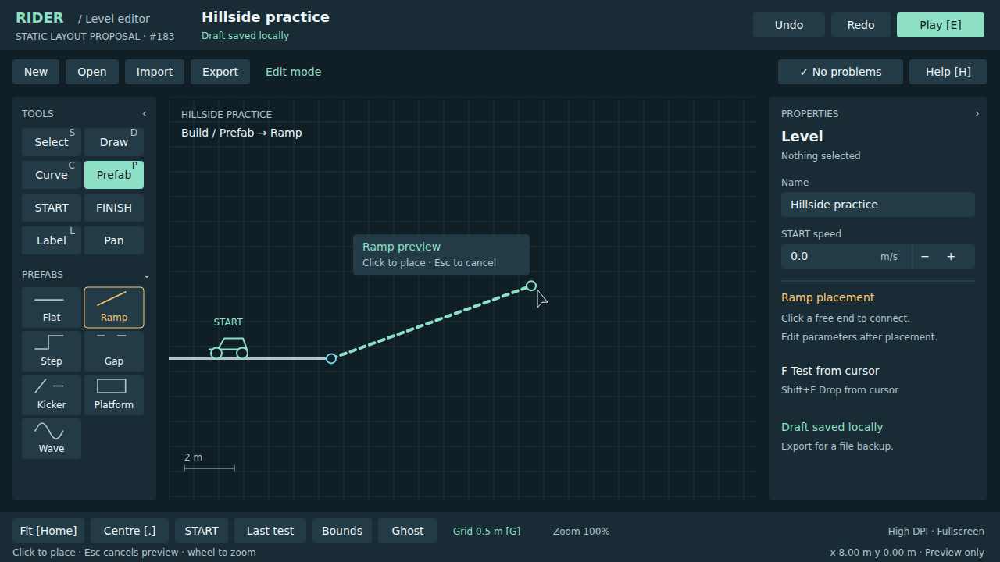
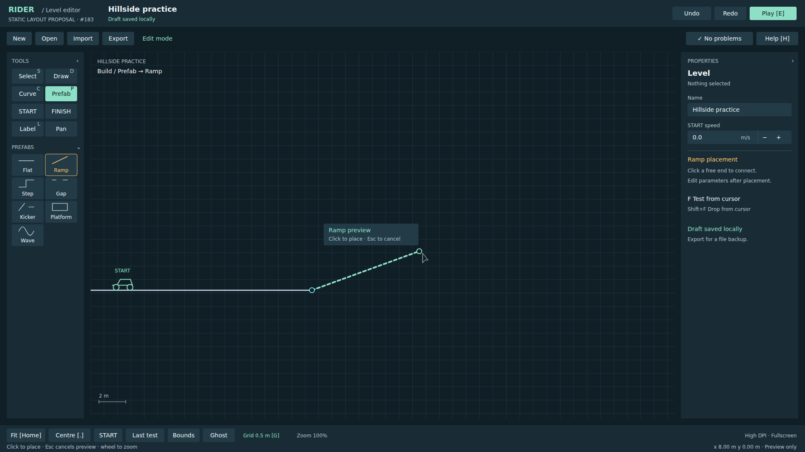
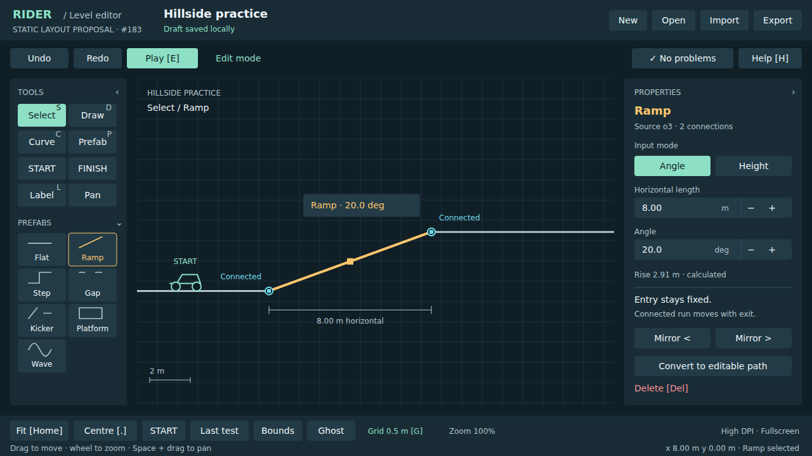
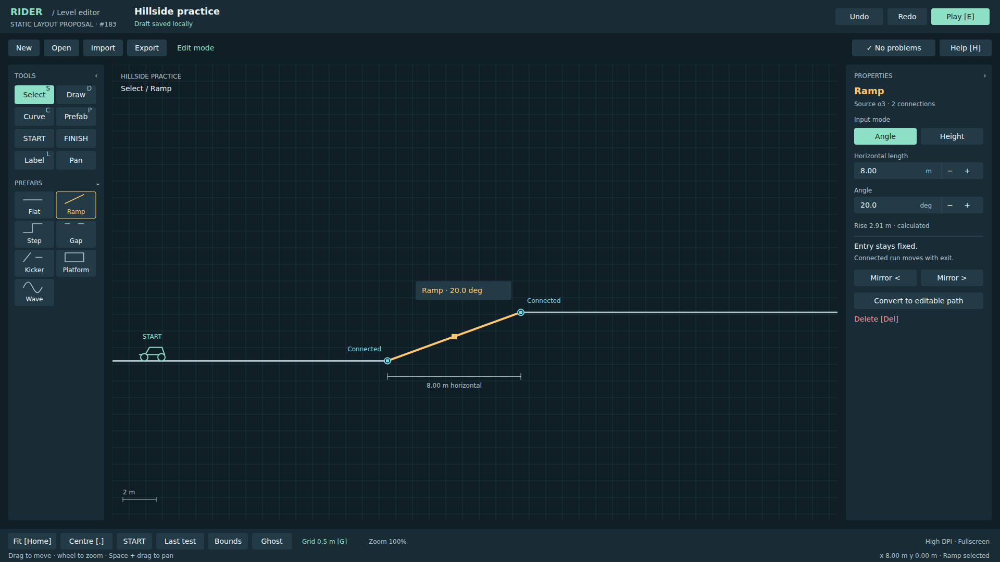

# Editor A layout previews

Static design proposal for [#183](https://github.com/bongohorse/rider/issues/183), based on Rider `0953bf048a34948542f53c657f278f685835f1fc`. These images are mockups, not screenshots of an implemented editor. The binding target specification, inspection findings, controls, visual tokens and budget estimate are in the [contract's screen-layout section](../contracts/level-editor.md#editor-a1a-layout-proposal-183).

Actual implementation screenshots for #171: [runtime gallery](runtime/README.md).

**Contents:** [Build](#build) · [Selected Ramp](#selected-ramp) · [Sources and reproduction](#sources-and-reproduction)

## Build

Prefab → Ramp placement preview, no object selected; level properties remain visible. Dashed geometry is pending placement. The free exit uses a hollow ring; the entry snaps to the existing flat.

[1280 × 720 PNG](build-1280x720.png) · [SVG](build-1280x720.svg)



[1920 × 1080 PNG](build-1920x1080.png) · [SVG](build-1920x1080.svg)



## Selected Ramp

Placed Ramp connected to the upstream flat and downstream flat. Horizontal length 8 m, angle 20 deg, calculated rise 2.91 m. Both fields have units and step controls; the two mode buttons expose Angle/Height directly. This is a later example state than the build image.

[1280 × 720 PNG](ramp-1280x720.png) · [SVG](ramp-1280x720.svg)



[1920 × 1080 PNG](ramp-1920x1080.png) · [SVG](ramp-1920x1080.svg)



## Sources and reproduction

[render_layouts.py](render_layouts.py) generates the four SVGs using Python's standard library. All diagrams are drawn for this proposal; no assets from another project or external downloads are used. DejaVu Sans is the local preview font, not an approved new runtime font. UI size stays constant between viewports; the work area expands.

Run from the repository root:

```sh
python docs/editor-a/render_layouts.py
```

PNG export uses the repository's existing Playwright installation and Chromium, at DPR 1. If this is an isolated worktree, point `NODE_PATH` at the existing checkout's `node_modules` before running:

```sh
node <<'JS'
const { chromium } = require('playwright');
const { resolve } = require('path');
const { pathToFileURL } = require('url');
(async () => {
  const browser = await chromium.launch({ headless: true });
  for (const [width, height] of [[1280, 720], [1920, 1080]]) {
    for (const state of ['build', 'ramp']) {
      const stem = resolve(`docs/editor-a/${state}-${width}x${height}`);
      const page = await browser.newPage({ viewport: { width, height }, deviceScaleFactor: 1 });
      await page.goto(pathToFileURL(`${stem}.svg`).href);
      await page.screenshot({ path: `${stem}.png` });
      await page.close();
    }
  }
  await browser.close();
})();
JS
```

Visual review covers the four static images only. Focus, scrolling, error handling, GUI allocation and rendering performance are specifications to verify during #171, after layout approval and its separate GO. No touch/device or interactive-editor evidence is implied. Claudio's approval must be recorded on #183 before #171 begins; merging documentation alone does not authorize implementation.
