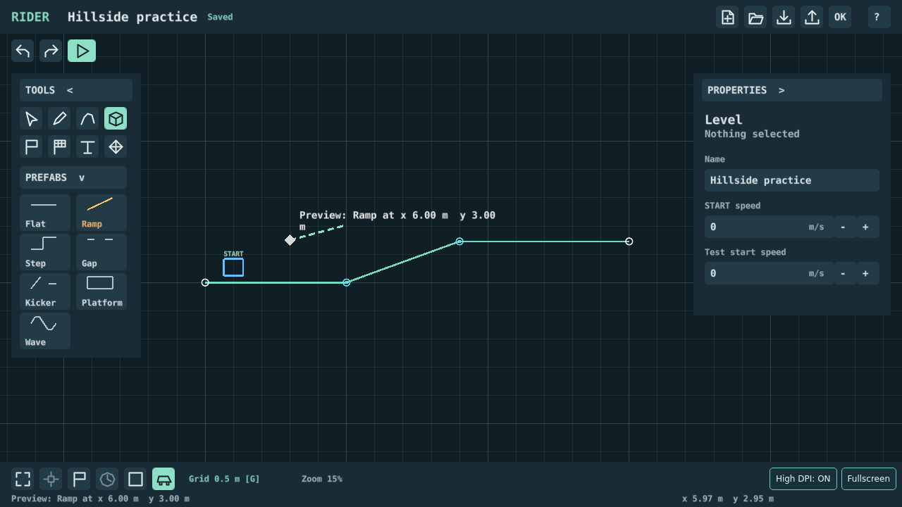
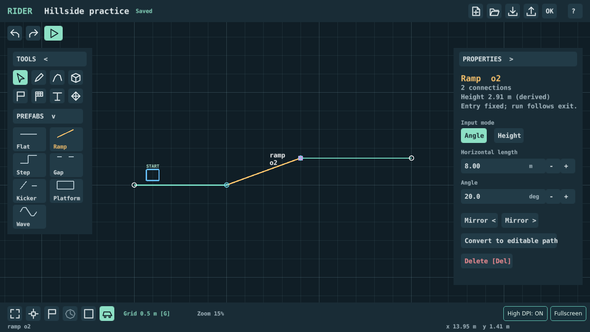
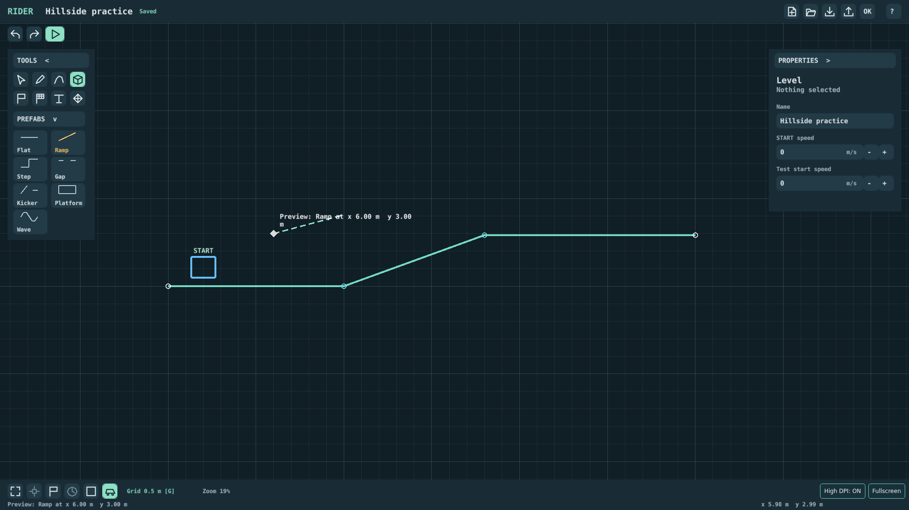
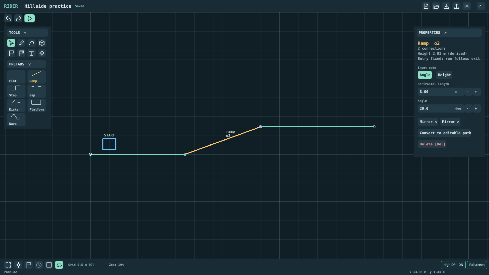
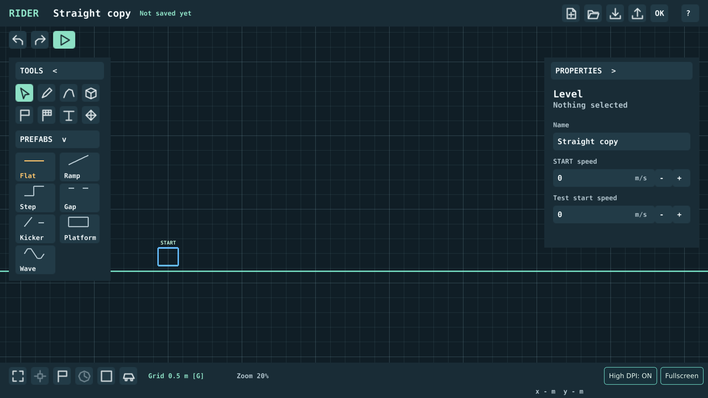
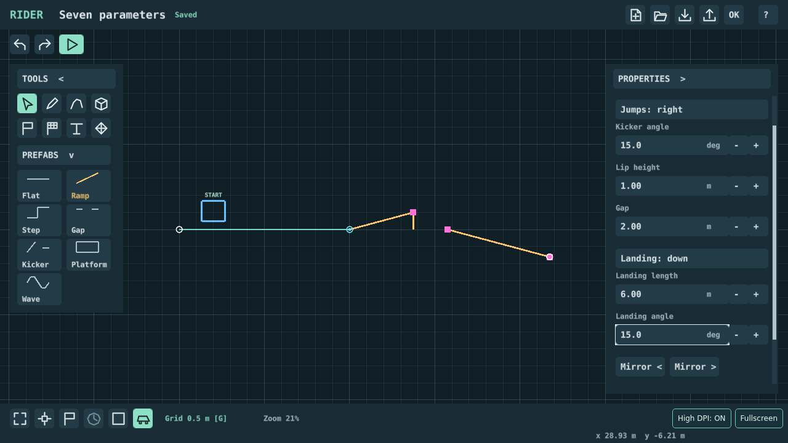
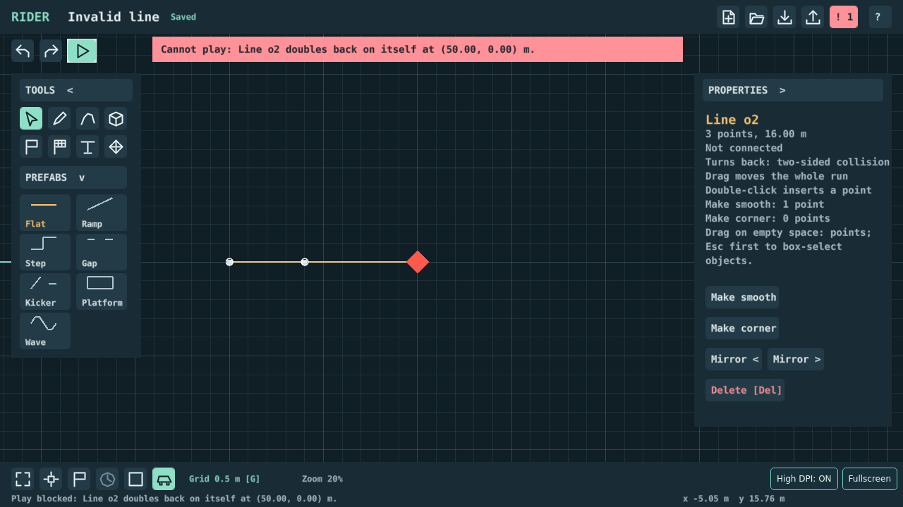
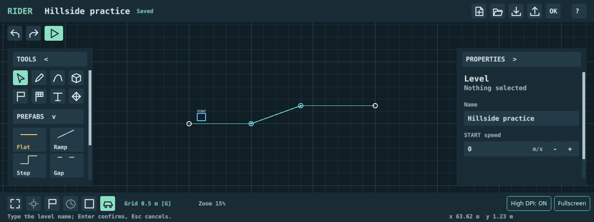

# Implemented Editor A UI

Actual HTML5 debug screenshots for [#171](https://github.com/bongohorse/rider/issues/171), captured by the extended `le6` browser protocol. These captures include Claudio’s 2026-10-21 compact-header, sidebar, icon and error feedback. The [original approved static designs](../README.md) remain separate. Behaviour and measured budgets are specified in the [editor contract](../../contracts/level-editor.md#editor-a1b-implementation-171).

**Contents:** [Desktop layouts](#desktop-layouts) · [HiDPI and scrolling](#hidpi-and-scrolling) · [Errors and short windows](#errors-and-short-windows) · [Capture identity](#capture-identity)

## Desktop layouts

Build / Prefab → Ramp, then selected Ramp (8 m horizontal length, 20 deg). These images show the rendered controls; the sample courses differ from the schematic proposal.

## HiDPI and scrolling

1280×720 CSS viewport, DPR 2 / 2560×1440 framebuffer. The logical control sizes match the DPR 1 layout.

The Kicker's seventh parameter is reached by scrolling its inspector. The wheel does not zoom the canvas or change geometry/history.

## Errors and short windows

A blocking error makes the header indicator red and flashes its source. Play immediately shows the error in a red banner and focuses its source, without requiring a second click.

At 1280×480, both sidebar bodies scroll by wheel or by dragging their scrollbars. Controls retain their desktop size. At the normal heights, short sidebars stop after their content and leave the canvas below them editable.

## Capture identity

Defold 1.14.0 (`a81dbb0478e8b73931dc2d671563204f6ac0ef82`), Playwright Chromium `156.0.8078.4` on Linux. The local debug bundle was built from base `c6fed8541110c662f2de479b7bd9ee8a0becb880` plus this task's working UI diff. Capture run `5597e102-4bbc-456b-ba25-d4afa5342593`, `tools/gym/smoke.py --bundle artifacts/171-feedback-debug-verified --output artifacts/171-feedback-verified-le6 --case le6` (14 cases PASS). Build inventory/engine guard and JSON results are retained locally in those artifact directories; PR-head CI independently rebuilds and runs the same protocol. Local working-diff captures are not claimed as committed-head or deployed-build evidence. Pointer/keyboard input is synthetic; these images do not establish physical-device behaviour or Claudio's practical acceptance.
