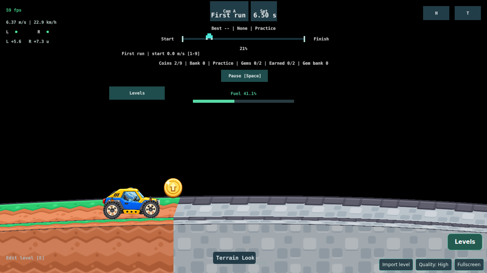

# Terrain materials, Stage A renderer spike (#392)

Historical report of the Stage A pull request (2026-11-03). Live state, the drive/look test and Stages B–D are on [#392](https://github.com/bongohorse/rider/issues/392). Evidence: [terrain-392/](terrain-392/).

**Contents:** [Result](#result) · [Temporary pilot selection](#temporary-pilot-selection) · [Renderer](#renderer) · [Measurements](#measurements) · [Findings for later stages](#findings-for-later-stages) · [Engine sources](#engine-sources) · [Verification and NOT RUN](#verification-and-not-run)

## Result

A real course (First run, `first-run`) renders Grass → Stone with a textured terrain mesh in Play and in Edit, in the pinned Defold 1.14.0 debug HTML5 build (headless Chromium). Textures come from a deterministic 24-slot atlas built from the official Kenney New Platformer Pack 1.1 ZIP (SHA-256 verified, CC0). The change is visual only: no physics, collision, level-format, editor or Terrain Look file changed. Without the pilot parameter every course keeps the untextured route.

## Temporary pilot selection

Stage B owns the level-source format, so Stage A selects the material only through the page URL, read once per page load by `main/terrain_perspective/material.lua`:

- `terrain_material=<family>` — one family for the whole course;
- `terrain_material=<left>,<right>@<x>` — `<left>` for every sample interval whose midpoint lies left of `x` metres, `<right>` otherwise (constant per interval, never interpolated).

Families: `grass`, `dirt`, `sand`, `snow`, `stone`, `purple`. Invalid text is ignored with one `RIDER_TERRAIN_MATERIAL ignored: …` console line and the course stays untextured. Both Play and Edit build terrain sections through `projection.section`, so the one hook textures both without editor changes. The parameter works in debug and release HTML5 builds, deliberately, so Claudio can drive it on the preview; it changes no saved data. While it is active, the textured 52 B stride also applies to level validation and import (`terrain_budget.check`), so a course of 20,165–21,845 vertices is refused only with the parameter; the largest built-in course (`bumps`) has 13,152. Stage B replaces the parameter with a versioned per-section field.

## Renderer

- **Atlas** (`main/terrain_material/`): 512×512 RGBA, six family rows × four columns (Surface `block_top`, Rim `horizontal_middle`, Side `block_center`, End `vertical_middle`), each 64 px tile in an 80 px cell with an 8 px edge extrusion. Generator `tools/art/terrain_material.py` checks the ZIP SHA-256, reads 24 PNGs and `License.txt` in memory and writes the atlas, `manifest.json` (ids, source SHA-256 per tile, rectangles, raw-pixel SHA-256) and the license. Two builds in separate directories gave byte-identical files (SHA-256 atlas `1260ee17…f543ea`, manifest `bbd8fcb7…91027`, license `f0bc5a99…316077`). [Provenance](../../main/terrain_material/PROVENANCE.md).
- **Separate route**: `textured_chunk.factory` (load dynamically) → `textured_chunk.go` → `textured_chunk.mesh` (`textures:` the atlas PNG) → `textured.material` (`tex0` sampler, clamp, linear min/mag, no mipmaps) with `textured.vp`/`textured.fp`. The untextured factory, mesh, material and shaders are unchanged.
- **Vertex stream**: one extra `float32` stream `texture_slot` = family × 4 + face, 48 → 52 bytes per vertex, only on textured sections. Positions, `look_data`, partition and arc-length U stay exactly as built (unit test).
- **UV**: Surface and Rim keep one cross-section (V clamped; Surface image top at the back edge, Rim image top at the road line), U repeats every 0.9 m of arc length. Side tiles 1 m × 1 m by arc length and world height, computed in the vertex shader after the bottom is resolved and before projection, so tall faces do not stretch. End caps get U 0 → 1 front to back and world-height V. Tile coordinates are section-local plus the fractional section phase/origin: they differ from the course-wide values by whole tiles (continuous across sections) but stay small, so precision holds far along long courses on GPUs that run fragments at mediump.
- **Vertical flip**: manifest rectangles use a top-left origin; the fragment shader flips V once (`1.0-px.y/ATLAS`). Screenshots show the Surface outline at the back edge and upright art.
- **Neutral tint**: textured faces use equal-RGB face shading (Surface 1.0, Rim 1.0, Side 0.86, End 0.74) instead of the green look tint; selection/hover gains in `terrain_mesh.colors` multiply these, and alpha stays the visibility channel.
- **Admission**: `terrain_budget` uses 52 B and one more retained Lua number per vertex (CPU working estimate 560 → 576 B/vertex: one more Lua 5.1 array slot, 16 B on HTML5) while the pilot is active.

## Measurements

Local runs, source `81f640d` (code identical to the PR head; only docs and evidence added after), headless Chromium 156.0.8078.4 on SwiftShader (software GL), 1280×720. Runner: [`tools/terrain_material/observe.cjs`](../../tools/terrain_material/observe.cjs); summary [observe-summary.json](terrain-392/observe-summary.json).

**Vertex stride (measured).** The runner computes each section's vertex count from the station JSON and hooks WebGL `bufferData`. Every First run section was uploaded as exactly vertices × 52 B with the pilot and vertices × 48 B without, never the other size:

| Section vertices | Untextured upload | Textured upload |
| --- | --- | --- |
| 1,158 | 55,584 B | 60,216 B |
| 1,152 (×4) | 55,296 B | 59,904 B |
| 294 | 14,112 B | 15,288 B |
| **6,060 (Fit total)** | **290,880 B** | **315,120 B** |

**1 MiB Fit limit.** With the measured 52 B stride the P5 660 m course (1,016 segments, 17 sections, 18,312 vertices) needs 952,224 B (untextured 878,976 B), 96,352 B under 1,048,576 B (`tests/gameplay/terrain_material.lua`). The largest admitted course shrinks from 21,845 to 20,164 vertices while textured; such courses get the existing actionable refusal, caps are unchanged.

**Atlas texture.** WebGL `texImage2D` shows the atlas as one 512×512 RGBA/UNSIGNED_BYTE level-0 upload (1,048,576 B) and no `generateMipmap`. Untextured runs upload no 512×512 texture (dynamic factory loading); a textured run uploads it once per world (Play, then again on entering Edit).

**Frame intervals** (ms, mean / p95; three repeats, untextured first in each):

| Repeat | Play idle U · T | Play driving U · T | Edit Fit U · T |
| --- | --- | --- | --- |
| 1 | 16.67/16.8 · 16.67/16.8 | 16.66/16.8 · 16.67/16.8 | 16.67/17.8 · 16.66/17.6 |
| 2 | 16.67/16.8 · 16.67/16.8 | 16.67/16.8 · 16.67/16.8 | 16.64/17.7 · 16.95/20.4 |
| 3 | 16.72/16.9 · 16.72/16.8 | 16.67/16.8 · 20.30/38.3 | 16.67/17.8 · 17.46/20.9 |

No consistent delta: both routes are vsync-bound at 16.67 ms; repeat 3's textured driving outlier has a same-sized untextured counterpart in an earlier run of the previous build (21.30/38.8). Software GL at 60 Hz; this says nothing about phone GPUs. These are local measurements, not desktop CI (see NOT RUN).

**Bundle size.** `game0.arcd` of the debug Gym bundle grows from 781,784 B (`main`) to 805,628 B (+23,844 B, compressed archive); the Wasm engines are unchanged.

**Untextured route unchanged.** [`legacy_compare.cjs`](../../tools/terrain_material/legacy_compare.cjs) renders First run, Gap landings and Rolling hills in Edit after Fit from a `main` build (`403e9a3`) and this build ([legacy-compare.json](terrain-392/legacy-compare.json)): 67 / 117 / 56 differing pixels, maximum channel delta 1/255. A control run of the same `main` bundle against itself ([legacy-control-main-vs-main.json](terrain-392/legacy-control-main-vs-main.json)) gives 11 / 0 / 1,216 pixels (delta up to 17), so frames vary run to run. Inside the terrain band (rows 330–440), First run's 11 differing pixels are at exactly the coordinates of the control's 11, Gap landings has 3 (delta 1) and Rolling hills none. Play was not pixel-compared (the car's settle frames vary); Play screenshots of both routes are in the evidence.

## Findings for later stages

- **Minification at Fit**: at 2.41 % editor zoom the unmipmapped atlas aliases into speckles ([screenshot](terrain-392/textured-edit-fit.png)). Driving zoom looks clean. Mipmaps need per-tile padding/LOD care in a shared atlas (Stage D).
- **Art mapping** is a spike choice, not accepted art: the 64 px Rim tile is squashed into the 0.18 m lip, and the Surface shows the side-view `block_top` over the 0.9 m depth. Art direction is Claudio's.
- The Terrain Look **shading** value does not affect textured faces (neutral shading instead); width/side depth still apply.
- `main/editor/editor_terrain.lua` still reports `buffer_bytes` with 48 B in its Edit statistics (diagnostic only; admission uses `terrain_budget`). Not changed here because #281 owns the editor files.
- The first textured section in a world loads the atlas synchronously (~1 MiB decode); not observed as a hitch in these runs.
- Stage A's #392 acceptance asks for memory/fit and frame-time deltas recorded on desktop CI; these are local runs only. The observer needs a Gym case in `tools/gym/smoke.py`, owned by the open #281 PR, so CI recording is deferred.
- Not compared: the 128 px/1024² atlas, nearest filtering, Android.

## Engine sources

Defold 1.14.0 (engine `a81dbb0`), checked 2026-11-03:

- [Mesh manual](https://defold.com/manuals/mesh/) (`tex0`, runtime buffers, AABB metadata) and pinned [`mesh_ddf.proto`](https://github.com/defold/defold/blob/a81dbb0478e8b73931dc2d671563204f6ac0ef82/engine/gamesys/proto/gamesys/mesh_ddf.proto) (`repeated string textures`).
- [Textured mesh example](https://defold.com/examples/mesh/textured/) and its [project files](https://github.com/defold/examples/tree/master/mesh/textured) (`textures: "<png>"` on a mesh, `uniform sampler2D tex0`, material `samplers`).
- [Material manual](https://defold.com/manuals/material/) (samplers, wrap/filter modes, tags) and pinned [`material_ddf.proto`](https://github.com/defold/defold/blob/a81dbb0478e8b73931dc2d671563204f6ac0ef82/engine/render/proto/render/material_ddf.proto) (`Sampler` fields).
- [Factory manual](https://defold.com/manuals/factory/) (Load Dynamically, synchronous load in `factory.create`) and pinned [`gamesys_ddf.proto`](https://github.com/defold/defold/blob/a81dbb0478e8b73931dc2d671563204f6ac0ef82/engine/gamesys/proto/gamesys/gamesys_ddf.proto) (`load_dynamically`).

The forum's runtime `go.set(..., "texture0", ...)` path was not needed: the texture is bound statically in the `.mesh`.

## Verification and NOT RUN

Run locally: `python tools/bootstrap_check.py`, `python tools/ci/lint_lua.py`, `python -m unittest discover -s tests/bootstrap`, `python tools/gameplay/lua_tests.py` (39/39, incl. `terrain_material.lua`), `python -m unittest discover -s tests/ci`, `node --test tests/ci/*.cjs`, the debug Gym bundle build via the loopback Extender, the observer and the legacy comparison above, and the Gym cases listed in the PR. CI `required` is the full gate.

NOT RUN: Claudio's drive/look test and art acceptance; Android and any real phone or GPU; hardware GPU memory/time; the Stage A observer in CI (adding a Gym case needs `tools/gym/smoke.py`, which #281's open PR owns).
