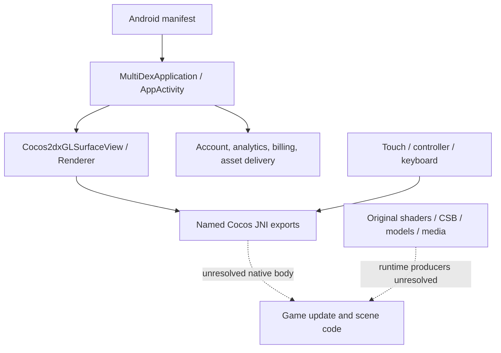

# HCR2 Technical Reference for Rider

Evidence-backed static research • English edition • 24 October 2026

## Executive overview

This reference explains what the supplied Hill Climb Racing 2 Android package can reliably teach us, and where it cannot yet answer an implementation question. It is **not an original-source restoration, a remake specification, or a runtime observation report**. Rider is described by the requester as a Defold/Box2D side-view buggy game with an editor; its source was not supplied or inspected here. Every Rider change below is an architectural proposal to validate against that implementation.

The most useful findings are:

1. **Terrain depth is partly implemented in ordinary vertex math.** Original terrain shaders move selected vertices toward a lower boundary, change depth and adjust texture coordinates. This gives a concrete way to separate a readable driving surface from a visually substantial terrain body. It does **not** establish the CPU's curve sampler, mesh topology, collision chain, camera projection or sampling interval. See the graphics chapter and its original shader citations.
2. **The Android/native boundary is observable.** Cocos renderer lifecycle and input bridges expose a practical division between platform services and native rendering/game code. An SDK or native class being packaged does not prove every capability is used by gameplay. See the Android chapter.
3. **Two-pedal air rotation and event-linked tuning effects are described in original content.** Tutorial text specifies brake → forward rotation and throttle → backward rotation. Original descriptions connect effects to pickups, flips, wheelies, landings and detachable parts. The equations, timing thresholds and balance constants remain unrecovered. [G01–G05](#gameplay-evidence)
4. **Presentation is substantially data-driven.** Original Cocos Studio layouts/timelines, particle property lists, atlases, models and shader variants expose content structures independently of most hidden gameplay code. Their serialized values are asset defaults, not measured runtime configuration. See the assets chapter.
5. **The earlier 'complete implementation' narrative is unreliable.** Camera constants, vehicle parameters, Catmull–Rom terrain, exact ghost records and several formulas appear in a JavaScript prototype or reconstructed C++ without a verified binary mapping. Passing those implementations' tests establishes their own behavior only. [Corrections](#corrections)

For Rider, prioritize a downhill-visibility camera experiment and a chunked terrain-mesh experiment. Both address stated problems without depending on missing HCR2 implementation details or adopting HCR2's visual direction wholesale. Follow with fixed-step vehicle instrumentation, reusable authored content and one authoritative race-state model. [Recommendations](#rider)

<a id="contents"></a>
## Contents

- [Provenance, confidence and limitations](#provenance)
- [Technical architecture and native evidence](#architecture)
- [Android startup, lifecycle and input](#android)
- [Terrain, depth, shaders and presentation assets](#graphics)
- [Gameplay, vehicles and tuning](#gameplay-evidence)
- [Timing, progress, modes, replay and persistence](#race-systems)
- [Performance and development techniques](#performance)
- [Corrections to previous reports](#corrections)
- [Prioritized independent Rider proposals](#rider)
- [Open questions and targeted investigations](#questions)
- [Evidence index](#evidence)
- [Glossary](#glossary)

<a id="provenance"></a>
## Provenance, confidence and research limitations

### Evidence rules

| Label | Meaning in this reference |
|---|---|
| **Confirmed** | The stated, bounded fact is directly supported by an inspected original artifact or a reproducible artifact-bound measurement. A confirmed string proves that text is shipped; it does not prove its screen is reached. |
| **Supported inference** | Multiple observations support an explanation, but a connection, configuration or implementation detail remains inferred. |
| **Unverified** | A claim exists in earlier reports, reconstructed source or the prototype without adequate original-artifact support. This does not mean the idea is necessarily false. |
| **Unknown** | The inspected evidence does not establish the answer. A bounded unsuccessful search is not proof of absence. |
| **Rider proposal** | An independently designed experiment/recommendation, not a finding about HCR2. These are marked separately from confidence labels. |

The claim register records source paths, locators, provenance, limitations and available identities. `FUN_*`, `DAT_*`, `local_*` and analyst-assigned class names are not presumed original symbols. Syntax-valid Java and completed C pseudocode remain decompiler interpretations. No supplied executable was run for this research. Gameplay videos, device traces and live server behavior were not acquired. No HCR2 assets or proprietary source should be transplanted into Rider.

### Source layers

| Layer | Workspace-relative location | What it can establish |
|---|---|---|
| Original containers | `/workspace/reference-apk/`, inventory [input_provenance.json](../decompiled/codex_verified/assets/input_provenance.json) | Supplied package identity and hash relationships; not publisher trust on its own. |
| Verified extracted originals | [decompiled/unpacked/](../decompiled/unpacked/) | Original asset/source bytes and package membership, subject to extraction hash records. |
| Actual Android output | [decompiled/android/dex/](../decompiled/android/dex/), [method register](../decompiled/codex_verified/android/methods_reconciled.jsonl) | DEX descriptors, bytecode, Smali and method-specific Java export status. |
| Actual native analysis | [decompiled/native/](../decompiled/native/), [codex_verified/native/](../decompiled/codex_verified/native/), [native_final](../decompiled/codex_verified/native_final/) | Input-bound disassembly, function hypotheses, attempts and pseudocode diagnostics. |
| Static derived bytes | [native_derived](../decompiled/codex_verified/native_derived/) | Separately identified transformations of original bytes; assumptions must accompany their use. |
| Schema-derived decoded assets | [assets/decoded](../decompiled/codex_verified/assets/decoded/), [schema sources](../decompiled/codex_verified/assets/schema/) | Parsed structures supported by a compatible reader/schema; not automatically runtime semantics. |
| Historical analyst reports | [specs/](../specs/), root Markdown, [decompiled/reports/](../decompiled/reports/) | Search leads and previous interpretations; assertions require corroboration. |
| Reconstructed C++ | [decompiled_src/cpp/](../decompiled_src/cpp/) | Proposed implementations with insufficient source-to-binary provenance. Six files are explicitly classified in [legacy_work_classification.json](../decompiled/codex_verified/provenance/legacy_work_classification.json). [P07–P08](#claim-p07) |
| Browser prototype | [src/](../src/), [index.html](../index.html), [test/](../test/) | Local prototype behavior and assumptions, never original-game correctness. |

### Measured recovery context

The following are **analysis-snapshot counts**, not claims of complete semantic understanding. These distinctions matter because much readable Android output belongs to platform/advertising/support libraries, whereas central native gameplay remains difficult to interpret.

| Measurement | Recorded value | Interpretation / evidence |
|---|---:|---|
| Supplied regular input files | 58 | Provenance inventory; containers and existing extracted input files are separate rows, not58 independent game builds. |
| Archive regular entries | 17,325 | Archive-member accounting, not decoded formats or independent assets. [archive_entries.json](../decompiled/codex_verified/assets/archive_entries.json) |
| APK packages | 36 | One base and35 splits; APKM container separate. |
| SHA-distinct native libraries | 30 | Ten per architecture: ARM64, ARMv7, x86_64. [package links](../decompiled/codex_verified/provenance/native_binary_package_links.json) |
| Defined DEX methods / bodies / declarations | 562,847 /529,347 /33,500 | Sixteen DEX including statically recovered embedded DEX. [M01](#claim-m01) |
| Syntax-verified structured Java bodies | 477,361 | Not semantic equivalence; includes synthetic and bridge methods. |
| Other selected executable-method outputs | 29,932 simplified;3,877 initializer fragments;18,177 with diagnostics | All529,347 bodies have fresh attempts and selected nonempty snippets; these categories are not all high-level implementations. [java_summary.json](../decompiled/codex_verified/android/java_summary.json) |
| Native metadata starts | 320,486 | Not proven complete functions;98,729 belongs to ARM64 Cocos alone. [M03](#claim-m03) |
| Raw-original Ghidra function objects | 69,624 | Function hypotheses, thunks and failed bodies included. [M02](#claim-m02) |
| Raw PF_X file-byte union | 123,175,991 bytes | Executable-marked segments can include data and padding. |
| Raw function-body PF_X union | 6,280,395 bytes | About5.10% of PF_X; not a measure of correct high-level source. |
| Raw listing instruction / defined-data / unclassified unions | 8,928,964 /18,234,102 /96,012,925 bytes | Decoder/listing classifications; unclassified does not mean encrypted. [totals.json](../decompiled/codex_verified/native_final/totals.json) |
| Raw completed pseudocode without `halt_baddata` | 28,054 | No-halt does not prove correctness. Other statuses include9,753 thunks,19,373 partial-with-halt,3,929 halt-only and concrete failures/conflicts. |

The native table describes the frozen raw-original analysis. Later isolated loader corrections and the separate201,440-byte derived ARM64 helper region must not be added naively: overlapping ranges require unions within the same input/derived identity. The helper-stage provenance records the assumed untraced-process key byte; its131 unwind-derived exports are not exhaustive game recovery. See the native chapter. Older asset summary files also retain obsolete Effekseer blockers; the specific newer runtime-parser evidence supersedes them. This report avoids treating a stale aggregate as the definitive current remaining-work total.


<a id="architecture"></a>
## Technical architecture and native evidence

This research establishes Cocos Android rendering/input integration and OpenGL ES dependencies. It does **not** establish Box2D integration or the game's terrain, camera, vehicle or physics algorithms. No full decompilation or runtime execution was performed for this research. Original inputs and prior results were preserved. Machine-readable claims, exact symbol records, addresses and SHA-256 evidence manifests are in [native_claims.json](native_claims.json).

## Primary binary and coordinates

Primary ARM64 ELF: `decompiled/native/arm64-v8a/libcocos2dcpp.so/libcocos2dcpp.so`, SHA-256 `32d1198004a39ecaec3fcf0e9aa4efdd2f3a73e52491fdb4ee11b9a0b7f26181`.

Dynamic symbols were read from PT_DYNAMIC rather than relying on missing section headers. [Collector](evidence/collect_native_research.py) and [selected records](evidence/selected_native_symbols.json) preserve symbol indices, symbol-table record file offsets, bindings, sizes and source hashes. There are 29,447 dynamic symbol records across the three libcocos ABIs; ARM64 has 9,792. ARM64 defines 119 `Java_` exports, of which 81 belong to `Java_com_fingersoft_hcr2_AppActivity_`; the earlier claim that all 119 were AppActivity functions is incorrect.

| Actual ARM64 symbol suffix | ELF VA / file offset | Ghidra address | ELF symbol size |
|---|---:|---:|---:|
| `Cocos2dxRenderer_nativeRender` | `0x1b31f74` | `0x1c31f74` | 28 |
| `Cocos2dxRenderer_nativeInit` | `0x1b301a8` | `0x1c301a8` | 376 |
| `Cocos2dxRenderer_nativeOnSurfaceChanged` | `0x1b303d0` | `0x1c303d0` | 180 |
| `Cocos2dxRenderer_nativeOnPause` | `0x1b31f90` | `0x1c31f90` | 224 |
| `Cocos2dxRenderer_nativeOnResume` | `0x1b32070` | `0x1c32070` | 224 |
| `Cocos2dxRenderer_nativeTouchesBegin` | `0x1b33338` | `0x1c33338` | 112 |
| `Cocos2dxRenderer_nativeTouchesMove` | `0x1b33418` | `0x1c33418` | 468 |
| `Cocos2dxRenderer_nativeKeyEvent` | `0x1b3380c` | `0x1c3380c` | 448 |
| `AppActivity_getTimeStampNow` | `0xdc09c0` | `0xec09c0` | 20 |

Renderer names above have full prefix `Java_org_cocos2dx_lib_`; AppActivity has prefix `Java_com_fingersoft_hcr2_`. Symbol sizes describe ELF records, not validated complete function bodies. The current original-ELF `nativeRender` inventory status is `halt_only_output`; its named C file is not a recovered render implementation. [Exact current records](evidence/native_bridge_inventory_records.json) preserve the distinction.

ELF VA maps to file offset through the containing file-backed PT_LOAD: `p_offset + (VA - p_vaddr)`, only within `p_filesz`. Ghidra coordinates come from actual saved MemoryBlockSourceInfo mappings in `decompiled/codex_verified/native/arm64-v8a/libcocos2dcpp.so/call_recovery/mapping.jsonl`. Selected JNI symbols above happen to have ELF VA equal to file offset and Ghidra VA larger by `0x100000`. This is not a global file-offset rule: ELF `0x2254000` maps to file `0x224c000`, Ghidra `0x2354000`.

## Rendering, timing and performance

[Original dynamic dependencies](evidence/cocos_arm64_dynamic.txt) include GLESv2, GLESv1_CM, EGL, OpenSLES, Android, log, dl, libc and libm. Undefined imported symbols include `glDrawArrays`, `glDrawElements`, `glBufferData`, `glTexImage2D`, `glUseProgram`, `clock_gettime`, `gettimeofday`, `usleep` and `nanosleep`. Their zero symbol values are import placeholders, not implementation addresses. These establish platform/API capability; they do not reveal the renderer's scene pipeline, batching, draw-call count, frame cost or camera projection.

The primary bytecode `decompiled/android/dex/base_classes_02/smali/org/cocos2dx/lib/Cocos2dxRenderer.smali` confirms the readable Java at `decompiled/android/jadx/base_classes_02/sources/org/cocos2dx/lib/Cocos2dxRenderer.java`. Raw bytecode is preserved at `decompiled/android/dex/raw/base_classes_02.dex`; all three hashes are in the claims manifest.

`Cocos2dxRenderer` defaults `sAnimationInterval` to 16,666,666 ns (Smali line 14). `setAnimationInterval(D)V` converts seconds to nanoseconds (line 88). `onDrawFrame` (line 205) skips drawing when `skipdraw` is set. For intervals at or below 16,666,666.666666666 ns it calls `nativeRender()` immediately; larger intervals sleep for the remaining whole milliseconds, update the stored nanoTime, then call `nativeRender()` (calls at lines 229 and 267). The native descriptor is `nativeRender()V` (line 73), with no timestep argument.

This supports a Java-side rendering throttle. It does not prove fixed 60 FPS, a fixed physics step, interpolation, solver iterations, deterministic simulation, or measured runtime performance. A timestamp-named native export similarly does not establish its implementation.

## Physics, terrain, camera and vehicle findings

No raw-byte matches for `Box2D`, `box2d`, `b2World`, `b2Body`, `b2WheelJoint`, `b2PolygonShape`, `b2ChainShape`, `b2EdgeShape`, `b2Fixture` or `b2ContactListener` were found in any of the 30 original ELF copies. [Search evidence](evidence/box2d_raw_byte_search.json) records every file's SHA-256, size and hits. No corresponding names appear in the independently parsed libcocos dynamic symbols across three ABIs.

This is bounded negative evidence. Hidden, transformed or stripped code may implement physics without these strings. **Box2D presence and API integration remain unconfirmed.** No verified native call chain currently connects a game physics step to a named Box2D implementation. The opaque file `decompiled/unpacked/base.apk/assets/Common/rube/driver.rube` has the shared binary prefix `1213aa1213ba13ba`; its filename alone establishes neither a parsed RUBE schema nor suspension parameters.

The terrain collision representation, vehicle chassis/joints, suspension model, torque/air control, gravity settings, camera tracking/projection and game update loop remain unknown from the inspected native evidence. Generic engine support cannot establish which features this game uses. No engine version or “2.5D hybrid” rendering architecture is established here.

Historical names including `TrackMeshPhysicsEvaluator`, `Box2DWorldStepSimulation`, `VehicleChassisJointSolver`, `TerrainGeometryGenerator` and `VehicleSuspensionModel` were hardcoded in `decompiled/scripts/RecoverCocosUnwindFunctions.java` (e.g. lines 27–28), then used in `decompiled/native/arm64-v8a/libcocos2dcpp.so/newly_recovered/newly_recovered_functions.json`. These are investigator-assigned labels, not original symbols or verified semantic implementations. Historical `DECOMP_INVENTORY.md` physics/suspension numerical claims lack primary evidence in this research and must not be cited as recovered facts.


### Languages, boundaries and conditional static recovery

**Confirmed:** original ELF symbols include C++-mangled NDK/libc++ material (for example symbol 429, `_ZNSt6__ndk16localeC2ERKS0_RKNS_12basic_stringIcNS_11char_traitsIcEENS_9allocatorIcEEEEi`). [N10](#claim-n10). Java/Smali establishes the Android host; GLSL assets establish shipped shader code. This does not identify every hidden native subsystem's original language.

The following diagram summarizes inspected interfaces, not a recovered scene/game-loop implementation:



**Supported inference, explicitly conditional:** a separately retained ARM64 Fingersoft helper-stage ELF applies a source-bound ChaCha8 transformation to 201,440 bytes at ELF VA `0x66fd80` plus 455 metadata bytes. The selected conditional key byte `0x46` is supported by independent code/FDE validation, not observed process state. Raw SHA256 `f9b4ee1664ec8b681da145d97dcbfbeefe6dd8c6a78d1543f22d25933e62c803` and derived SHA256 `815c8c438462532191950c7c9bb8d2c6941dc39abf27beffd3be41bdfaeffd49` must remain distinct. The file is not a captured runtime image and does not apply every initializer/GOT/state write. Its 131 unwind-derived exports do not resolve the game physics, camera or terrain producers. [N11](#claim-n11), [targeted run](../decompiled/codex_verified/native_derived/arm64-v8a/libfingersoft_hcr2.so/helper_stage/analysis/run.json).


<a id="android"></a>
## Android startup, lifecycle, input and services

The supplied Android launch path uses `AppActivity` and the Cocos2dx Java integration. Input, rendering and several lifecycle operations cross JNI into native code; the Java sources support a platform-boundary description, not a reconstruction of driving physics or replay/network algorithms. All findings below are **Confirmed static path/configuration facts** within their stated scope; AND-023 is an **Unknown** feature conclusion supported only by a bounded negative search. No SDK capability is promoted to observed execution. The claim ledger records source hashes, exact locators, confidence and limitations.

## Startup and native loading

**AND-001.** The manifest declares androidx.multidex.MultiDexApplication as Application, com.fingersoft.hcr2.AppActivity as the game activity, and cocos2dcpp as android.app.lib_name. Manifest configuration is static evidence; it is not an observed launch trace. Evidence: [AndroidManifest.xml (line 94)](../decompiled/android/apktool/base/AndroidManifest.xml).

**AND-002.** MultiDexApplication extends nmokwhs.ab. attachBaseContext calls its superclass, CrashpadLoader.onAttachBaseContext, then MultiDex.install. Its class initializer calls nmokwhs.d.b(). Native callbacks and class initialization side effects can add behavior beyond this explicit Dalvik sequence. Evidence: [MultiDexApplication.smali (line 1)](../decompiled/android/dex/base_classes_03/smali/androidx/multidex/MultiDexApplication.smali), [MultiDexApplication.java (line 8)](../decompiled/android/jadx/base_classes_03/sources/androidx/multidex/MultiDexApplication.java).

**AND-003.** nmokwhs.d.c() calls W.c(), then d.d(); d.d explicitly calls System.loadLibrary("fingersoft_hcr2"). The superclass nmokwhs.ab class initializer calls d.b(). This establishes a Java-driven bootstrap path, not a complete native dependency order or proof of what the native initializer does. Evidence: [d.smali (line 172)](../decompiled/android/dex/base_classes_02/smali/nmokwhs/d.smali), [ab.smali (line 7)](../decompiled/android/dex/base_classes_01/smali/nmokwhs/ab.smali), [d.smali (line 37)](../decompiled/android/dex/base_classes_02/smali/nmokwhs/d.smali).

**AND-004.** CrashpadLoader loads bts and initializes its hookable library list with backtrace-native and crashlytics-common. Its onAttachBaseContext initializes the native library directory and attempts to load the listed libraries. Loading attempts catch UnsatisfiedLinkError; these sources do not prove successful initialization on a device. No explicit wtp load is established by this inspected chain. Evidence: [CrashpadLoader.smali (line 19)](../decompiled/android/dex/base_classes_01/smali/no/promon/backtrace_support/CrashpadLoader.smali), [CrashpadLoader.smali (line 69)](../decompiled/android/dex/base_classes_01/smali/no/promon/backtrace_support/CrashpadLoader.smali).

**AND-005.** AppActivity.onCreate calls Cocos2dxActivity.onCreate, attaches ControllerInput, registers PlayGamesInput, then configures platform services after checking the native-library error flag. Initialization is conditional on successful earlier work; no runtime launch or traffic was observed. Evidence: [AppActivity.java (line 1888)](../decompiled/android/jadx/base_classes_05/sources/com/fingersoft/hcr2/AppActivity.java), [AppActivity.smali (line 7288)](../decompiled/android/dex/base_classes_05/smali/com/fingersoft/hcr2/AppActivity.smali).

## Rendering and input

**AND-006.** The activity builds a Cocos2dxGLSurfaceView, installs Cocos2dxRenderer, and calls onLoadNativeLibraries during onCreate. onLoadNativeLibraries reads android.app.lib_name and calls CrashpadLoader.loadLibrary. This proves Cocos2dx-style Java integration on the launch path, not an exact upstream Cocos2d-x version or an unmodified engine. Evidence: [Cocos2dxActivity.java (line 131)](../decompiled/android/jadx/base_classes_02/sources/org/cocos2dx/lib/Cocos2dxActivity.java), [Cocos2dxActivity.java (line 203)](../decompiled/android/jadx/base_classes_02/sources/org/cocos2dx/lib/Cocos2dxActivity.java).

**AND-007.** The GL view requests an EGL client context version of 2 and uses the custom FSGLSurfaceView layer. A requested context version does not establish every native graphics feature, extension, backend, or shader version used. Evidence: [Cocos2dxGLSurfaceView.java (line 133)](../decompiled/android/jadx/base_classes_02/sources/org/cocos2dx/lib/Cocos2dxGLSurfaceView.java), [Cocos2dxGLSurfaceView.smali (line 513)](../decompiled/android/dex/base_classes_02/smali/org/cocos2dx/lib/Cocos2dxGLSurfaceView.smali).

**AND-008.** Surface creation forwards screen dimensions to nativeInit; frame callbacks call nativeRender. The Java renderer keeps a default 16,666,666 ns animation interval, supports changing it, and can sleep when a longer interval is configured. This is render-callback pacing. It does not prove the native physics timestep, deterministic simulation, frame-to-tick ratio, or replay determinism. Evidence: [Cocos2dxRenderer.java (line 97)](../decompiled/android/jadx/base_classes_02/sources/org/cocos2dx/lib/Cocos2dxRenderer.java), [Cocos2dxRenderer.java (line 7)](../decompiled/android/jadx/base_classes_02/sources/org/cocos2dx/lib/Cocos2dxRenderer.java), [Cocos2dxRenderer.smali (line 205)](../decompiled/android/dex/base_classes_02/smali/org/cocos2dx/lib/Cocos2dxRenderer.smali).

**AND-009.** Touch handling gathers pointer IDs and getX/getY values, handles down/up/move/cancel and additional-pointer actions, and queues renderer calls on the GL event queue. Renderer handlers forward these values to nativeTouchesBegin/Move/End/Cancel. Native coordinate conversion, UI hit testing, pedal scaling and driving physics are beyond this Java boundary. Evidence: [Cocos2dxGLSurfaceView.java (line 240)](../decompiled/android/jadx/base_classes_02/sources/org/cocos2dx/lib/Cocos2dxGLSurfaceView.java), [Cocos2dxRenderer.java (line 52)](../decompiled/android/jadx/base_classes_02/sources/org/cocos2dx/lib/Cocos2dxRenderer.java).

**AND-010.** ControllerInput replaces the activity Window.Callback while retaining the prior callback and registers an InputDeviceListener. AppActivity explicitly attaches it. This is a direct integration path; it does not prove which devices were connected or used during gameplay. Evidence: [ControllerInput.java (line 49)](../decompiled/android/jadx/base_classes_05/sources/com/fingersoft/hcr2/ControllerInput.java), [ControllerInput.smali (line 210)](../decompiled/android/dex/base_classes_05/smali/com/fingersoft/hcr2/ControllerInput.smali), [AppActivity.java (line 1888)](../decompiled/android/jadx/base_classes_05/sources/com/fingersoft/hcr2/AppActivity.java).

**AND-011.** For eligible motion events, the controller bridge reads axes 0,1,15,16 and maxima of axis pairs (23,17) and (22,18), then queues six floats to nativeGamepadAxis indices 0 through 5. The native meanings, deadzones, response curves and vehicle effects of these six channels are not established here. Evidence: [ControllerInput.java (line 420)](../decompiled/android/jadx/base_classes_05/sources/com/fingersoft/hcr2/ControllerInput.java), [ControllerInput.smali (line 861)](../decompiled/android/dex/base_classes_05/smali/com/fingersoft/hcr2/ControllerInput.smali).

**AND-012.** Keyboard and gamepad events are mapped separately and forwarded to nativeKeyboardButton or nativeGamepadButton. Editing text and visible overlays receive special routing. Overlay detection includes ComposeView and Fingersoft home/account package prefixes. Overlay-routing support is not proof that the full game UI uses Compose, or that every advertised control changes vehicle state. Evidence: [ControllerInput.java (line 446)](../decompiled/android/jadx/base_classes_05/sources/com/fingersoft/hcr2/ControllerInput.java), [ControllerInput.java (line 42)](../decompiled/android/jadx/base_classes_05/sources/com/fingersoft/hcr2/ControllerInput.java), [ControllerInput.java (line 247)](../decompiled/android/jadx/base_classes_05/sources/com/fingersoft/hcr2/ControllerInput.java).

**AND-013.** Play Games input-map registration is conditional on the com.google.android.play.feature.HPE_EXPERIENCE system feature. It installs Hcr2InputMap and clears the provider on unregister. This proves a platform-specific registration path; the analysis did not run a Play Games PC environment. Evidence: [PlayGamesInput.java (line 9)](../decompiled/android/jadx/base_classes_05/sources/com/fingersoft/hcr2/PlayGamesInput.java).

**AND-014.** The advertised input map labels left as Navigate left / Brake / Reverse and right as Navigate right / Accelerate; it also exposes selection, pause, tab/navigation and action-button labels. These are mapping-provider labels and key bindings, not recovered torque/brake formulas. Provider InputIdentifier values must not be conflated with ControllerInput native button IDs. Evidence: [Hcr2InputMap.java (line 15)](../decompiled/android/jadx/base_classes_05/sources/com/fingersoft/hcr2/Hcr2InputMap.java), [Hcr2InputMap.smali (line 92)](../decompiled/android/dex/base_classes_05/smali/com/fingersoft/hcr2/Hcr2InputMap.smali).

**AND-015.** The sensor bridge obtains sensor type 1, can register/unregister its listener, applies orientation-dependent adjustments, and queues three sensor values plus the timestamp to native onSensorChanged(FFFJ). Bridge capability is established. An actual gameplay call enabling it, tilt-based driving, and the native interpretation are not established by these reads. Evidence: [Cocos2dxAccelerometer.java (line 18)](../decompiled/android/jadx/base_classes_02/sources/org/cocos2dx/lib/Cocos2dxAccelerometer.java), [Cocos2dxAccelerometer.smali (line 76)](../decompiled/android/dex/base_classes_02/smali/org/cocos2dx/lib/Cocos2dxAccelerometer.smali), [Cocos2dxGLSurfaceView.java (line 85)](../decompiled/android/jadx/base_classes_02/sources/org/cocos2dx/lib/Cocos2dxGLSurfaceView.java).

**AND-016.** Engine helper initialization passes the APK source path and Android Context/AssetManager to native functions, constructs the accelerometer helper, and supplies audio-device information. The Java bridge does not reveal native asset decoding, scene formats, audio mixing or asset-to-gameplay semantics. Evidence: [Cocos2dxHelper.java (line 188)](../decompiled/android/jadx/base_classes_02/sources/org/cocos2dx/lib/Cocos2dxHelper.java).

## Services, network boundaries and remaining uncertainty

**AND-017.** The app-authored startAnalytics path initializes Firebase analytics conditionally, logs an AppsFlyer af_login event, and calls initFSHome. This is stronger evidence than SDK package presence. The native or other calling conditions, consent state, actual transmitted data, and live SDK activation were not observed. Evidence: [AppActivity.java (line 1511)](../decompiled/android/jadx/base_classes_05/sources/com/fingersoft/hcr2/AppActivity.java), [AppActivity.smali (line 5566)](../decompiled/android/dex/base_classes_05/smali/com/fingersoft/hcr2/AppActivity.smali).

**AND-018.** CFirebaseAnalytics initializes Firebase, obtains FirebaseAnalytics and conditionally FirebaseRemoteConfig, enables analytics collection in this code path, and has an asynchronous remote-config fetch/activation path. Remote-config capabilities do not prove which keys or gameplay parameters are used, and static configuration does not prove network execution or current server values. Evidence: [CFirebaseAnalytics.java (line 38)](../decompiled/android/jadx/base_classes_05/sources/com/fingersoft/hcr2/firebase/CFirebaseAnalytics.java), [CFirebaseAnalytics.java (line 216)](../decompiled/android/jadx/base_classes_05/sources/com/fingersoft/hcr2/firebase/CFirebaseAnalytics.java), [AppActivity.java (line 426)](../decompiled/android/jadx/base_classes_05/sources/com/fingersoft/hcr2/AppActivity.java).

**AND-019.** The startup code configures FingerAccount with an HTTPS account endpoint and configures LiveopsManager with a separate HTTPS live-ops endpoint. Library-link failures have another explicit HTTPS reporting endpoint. Literal endpoint configuration is not evidence of live availability, successful traffic, a race-network protocol, transport guarantees for all native traffic, or server-authoritative physics. Evidence: [AppActivity.java (line 1903)](../decompiled/android/jadx/base_classes_05/sources/com/fingersoft/hcr2/AppActivity.java), [AppActivity.java (line 1944)](../decompiled/android/jadx/base_classes_05/sources/com/fingersoft/hcr2/AppActivity.java), [AppActivity.java (line 2604)](../decompiled/android/jadx/base_classes_05/sources/com/fingersoft/hcr2/AppActivity.java).

**AND-020.** The app exposes an asynchronous FSHome game-data retrieval bridge selecting public or private access and routing success/failure callbacks. The game-data payload meaning is not established. It must not be identified as a replay, ghost, race state or save format from this method name alone. Evidence: [AppActivity.java (line 576)](../decompiled/android/jadx/base_classes_05/sources/com/fingersoft/hcr2/AppActivity.java), [AppActivity.smali (line 2258)](../decompiled/android/dex/base_classes_05/smali/com/fingersoft/hcr2/AppActivity.smali).

**AND-021.** FSAssetPackManager uses Google Play AssetPackManagerFactory, registers a state listener, and implements fetch(list) and getPackLocation paths. AppActivity constructs this manager. This establishes asset-delivery integration, not the names, runtime availability, necessity, or contents of any external pack. Evidence: [FSAssetPackManager.java (line 32)](../decompiled/android/jadx/base_classes_05/sources/com/fingersoft/hcr2/FSAssetPackManager.java), [FSAssetPackManager.java (line 78)](../decompiled/android/jadx/base_classes_05/sources/com/fingersoft/hcr2/FSAssetPackManager.java), [AppActivity.java (line 1916)](../decompiled/android/jadx/base_classes_05/sources/com/fingersoft/hcr2/AppActivity.java).

**AND-022.** App lifecycle code forwards pause/resume to the Firebase ads wrapper and GooglePlayBillingHandler when those objects exist, with inventory/pending-purchase query logic on resume. Conditional integration is established; particular purchases, ad providers, impressions, or runtime SDK responses are not. Evidence: [AppActivity.java (line 2326)](../decompiled/android/jadx/base_classes_05/sources/com/fingersoft/hcr2/AppActivity.java), [AppActivity.java (line 2378)](../decompiled/android/jadx/base_classes_05/sources/com/fingersoft/hcr2/AppActivity.java).

**AND-023.** A bounded case-insensitive search for whole words replay, ghost, rollback, lockstep and deterministic found no matches in the inspected com/fingersoft/hcr2 Java package after excluding generated R.java. This is a scoped negative result, not proof that replay/multiplayer/deterministic simulation is absent. Native code and other packages were outside that search; Java decompiler omissions also constrain it. Evidence: [inspected game-package Java directory](../decompiled/android/jadx/base_classes_05/sources/com/fingersoft/hcr2).

The input-map labels are useful evidence for a platform control contract. They do not establish acceleration/braking equations, suspension constants, coordinate-to-world conversion, simulation time stepping, replay serialization, network reconciliation, or authoritative server behavior. Those questions require corroborating native implementation or suitable runtime evidence. SDK classes and endpoint strings alone are insufficient.

Machine-readable evidence: [android_claims.json](android_claims.json). Existing recovery files and previous reports were left unchanged.


<a id="graphics"></a>
## Terrain, depth, shaders and presentation assets

All findings in this chapter concern **shipped source/data**, not captured rendering. Program selection, uniform producers, framebuffer configuration, blend/depth state and CPU update order require separate evidence. Claim IDs prefixed `AS-` link to exact paths, line ranges or decoded-asset pointers and hashes.

### Terrain representation and shader-side edge extension

**Confirmed — vertex contract.** In original `terrain.vsh`, `a_position.xyz` supplies geometry, `a_texCoord.xy` UV, `.z` lighting and `.w` a `drawToEdge` factor. `a_position.w` is forwarded as a separate multiplier. The following is a direct mathematical restatement of the original shader, **not recovered CPU pseudocode**: [AS-G01–G03](#claim-as-g01)

```text
e = a_texCoord.w
newY = (1-e)*y + e*min(y + u_params.y, u_cameraBottom)
texScale = (newY-y) / u_params.y
finalXYZ = (x, newY, z) + (u_params.x*e, 0,
                                         u_params.z*max(1,texScale)*e)
clipPosition = CC_MVPMatrix * (finalXYZ, 1)
UV.y += u_params.w * texScale
```

For an edge factor of 0 the vertex retains its original location. For 1 the lower edge can extend to the smaller of a configured lower position and supplied camera bottom. Fractional values interpolate. The shader also extends tiling and changes depth. Its fragment program samples `CC_Texture0`, multiplies RGB by interpolated lighting and applies the separate multiplier; a declared `u_texture` is unused in the active expression.

This is a concrete **visual terrain-body mechanism**. Neither its world units nor the sign/range of CPU uniforms is established. There is no shader-side guard here against `u_params.y==0`. It does not reveal whether CPU geometry uses pairs, strips, indexed triangles, baked meshes or chunk pooling. It also does not prove that the top edge equals a Box2D collision spline. The prototype's negativeZoffset is not identical to this shader's signed addition. [P06](#claim-p06)

**Unknown — authored curve and collision compilation.** Catmull–Rom, Bézier, Hermite, linear control segments, arc-length sampling, adaptive tessellation, terrain chunk size and runtime assembly are not established by the inspected originals. Opaque `.json`/`.rube` files cannot supply their parameters yet. These questions must stay separate from the confirmed GPU expression.

### Depth, projection and authored models

**Confirmed.** `tunnel.vsh` projects explicit xyz through `CC_MVPMatrix` and treats position.w as lighting; its fragment code multiplies texture RGB by that light without multiplying alpha by it. This is vertex-authored lighting, not evidence of dynamic tunnel occlusion or a cylindrical CPU generator. [AS-G04–G05](#claim-as-g04)

An original arena-ramp OBJ has differing Z coordinates, 77 position vertices, 126 UV records and 91 face records. Its header identifies Blender 2.91.2 and `arena-ramp12.blend`; the accompanying MTL supplies material coefficients and `map_Kd arena-ramp.png`. [AS-M01–M02](#claim-as-m01). This proves authored 3D geometry in that asset. It does not establish its collision mesh, current rendering, importer treatment of every material coefficient, or a globally perspective-rendered/3D simulated game.

`CC_MVPMatrix` alone cannot distinguish orthographic from perspective projection. A camera can project depth-bearing geometry orthographically. Conversely, apparent depth can come from layering, vertex color, UVshifts and authored geometry without 3D physics. For Rider's stated 2D direction, the transferable lesson is separation of collision, visual edge, body fill and background; copying a perspective camera is unnecessary.

### Materials, height effects and parallax

**Confirmed.** The caustic surface shader derives its blend from `clamp((vertexY-u_depthfade.y)/u_depthfade.x,0,1)`. Its fragment stage mixes base textures, applies lighting and adds shifted texture RGB weighted by alpha, the coefficient and `9.5*y*(1-y)^3`. Here `depthfade` is a **height-derived factor**, not sampled depth-buffer information. [AS-G06–G07](#claim-as-g06)

`parallax_multi.vsh` uses `CC_PMatrix` and divides incoming UV.y by `multi_size`. The fragment code selects nine supplied strip entries through a wrapped floor-based index, scaling horizontal coordinates by `aspectX/multi_scale`. This is a texture-layer/strip selection mechanism; layer velocity, CPU camera coupling and actual draw order are unknown. [AS-G08–G09](#claim-as-g08)

`model_float.vsh` adds `u_b*sin(u_a*CC_Time[0])` to **clip-space Y after MVP** and flips UV.y. This must not be described as a world-space buoyancy/rigid-body simulation. Under perspective, clip-space modification can have different screen consequences depending on W. [AS-G10](#claim-as-g10). The waterfall vertex shader transforms a supplied player position using `u_ssize_cview` and `CC_PMatrix`; it proves an input dependency, not its native producer or camera law. [AS-G11](#claim-as-g11)

### Particles, liquids and postprocessing

**Confirmed.** A liquid postprocess samples a field from `CC_Texture0`, derives `d=(0.5/16)/field.a`, and, when `d<1`, samples `CC_Texture1` at `0.5+d*normalize(field.rg-0.5)`; otherwise it discards. This gives a concrete two-texture field/composition contract. The accumulation pass, field-generation algorithm, blend state, target resolution and simulation are unknown. [AS-G12](#claim-as-g12)

Droplet distortion has an active intensity threshold `u_intensity>0.01`, procedural masks, a centered 1.075 scale distortion and water tint; below that it copies the source texture. Weather activation and effect curves remain unknown. A shader named `postprocess_generic2` only copies `CC_Texture0` in active main; `particle_animated_2.fsh` likewise performs a direct copy despite declarations/debug code. Filename-based claims of implemented complex effects are unwarranted. The sky fragment is simply sampled texture times `u_color`. [AS-G13–G16](#claim-as-g13)

**Confirmed — serialized effect data.** The supplied `pinata_trail.efkefc` contains original editor XML and a runtime `BIN_` identical to its sibling `.efk`. Editor metadata says ToolVersion 1.53e. A compatible authoritative Effekseer 1.53c reader consumed all 1,988 runtime bytes through279 typed reads, revealing five nodes: root, two None parents and two Track leaves. This was a parser invocation, not effect-script execution, simulation or rendering. [AS-P01,AS-P04](#claim-as-p01)

One stored parent has `MaxGeneration=1`, `life` 100, `generationTime=1`, transform binds `Always`, translation `(-0.9,-0.2,0)` with zero velocity/acceleration and rotation velocity X approximately 0.104719758. A Track leaf stores `MaxGeneration=2147483647`, lifetime 100, generationTime 1 and binds `WhenCreating`. These are **reader-bound serialized values**; no actual concurrent particle count, world-unit scale, timebase or game attachment is inferred. [AS-P02–P03](#claim-as-p02)

### Vehicle-specific visual effects

**Confirmed.** Wheel sprite-sheet vertex code transforms mask UV through `u_transform`, adjusts the atlas center/aspect and supplied sheet dimensions. Its comment names `SpriteTransforms::setMaskUniforms()` as a possible native producer to search; the comment is not a verified call binding. The fragment program blends/selects sheet tiers according to `u_blend`/`u_blendmode`, retains alpha from tier 0 and multiplies by tint/vertex color. This establishes visual tier blending, **not tire wear, damage, grip or upgrade semantics**. [AS-V01–V02](#claim-as-v01)

Rotational texture blur takes 10 samples, accumulates squared RGBA and outputs `sqrt(sum/10)`; an annular spinner region takes one stationary sample. The translation-blur code is commented out. This is not evidence of a fullscreen velocity-buffer pipeline. Iridescent vehicle shading uses mask/base textures, normalized fragment coordinates, time and `0.25*u_playerRot`, synthesizes HSV color and overlays with a 0.2-weighted mask. Actual wheel-speed/orientation producers remain unknown. Box-blur behavior follows exact nested-loop bounds and the supplied step; normalization cannot be assumed from its name. [AS-V03–V05](#claim-as-v03)

### UI layouts, timelines and feedback

**Confirmed — authored layout, not universal device dimensions.** The decoded `reward_popup_currency.csb` root is a 960×640 Layer with zero-duration action and no timelines. A `closer` button has touch enabled, alpha 221, approximately `(481.44,320)` position and 1344×704 size; its callback fields are empty. This supports an oversized authored hit area but **does not prove dismissal behavior**, which may be bound in code. It does not establish global UI scaling or device resolution. [AS-U01–U02](#claim-as-u01)

`season_rank_icon_item.csb` stores action duration 1393 and speed 0.5, plus 25 named clips: `rank1` frames 0–18, `rank6` 385–401 and `rank6_idle` 1325–1393. Timelines bind through `actionTag`; stored entries include frameIndex, tween and easingData. A position key at frame 385 for tag `-1247020007` stores `(0,0)`, tween 1 and easing type 0. These are **frame indices**, not seconds; trigger conditions and framebase are unresolved. [AS-U03–U04](#claim-as-u03)

The verified CSB decoder uses pinned compatible Cocos readers/schema, including animation/timeline structures; it should be preferred to historical exports with incorrect wrapper/field assignments. Runtime node binding, localization substitution, HUD quantities, screen navigation and callback order remain separate questions. A layout name such as `CupRacePanel` does not establish its complete logic.

### Textures, atlases and audio

**Confirmed.** The `savanna_gfx.plist` specifies TexturePacker format 3, a 512×1024 RGBA8888 texture and `premultiplyAlpha=false`. Its tree frame defines a packed rectangle, 512×512 source size, offset and no rotation. Another original atlas has a 1254×1032 texture, Linear filters, packed bounds and optional 90° rotations/offsets. These are actual placement contracts; they do not establish runtime blend state, batch membership or animation scheduling. [AS-A01–A02](#claim-as-a01)

`backfire_single.ogg` fully decodes to 4,145 mono samples at 48,000 Hz, about 0.086354 seconds. Its filename is an intended-use lead; trigger, mixing gain, pitch scaling, looping and voice management are unknown. OpenSLES imports establish audio capability separately. [AS-AU01](#claim-as-au01)

### Formats, serialization and coverage limits

The base asset inventory records 128 `.vsh`,126 `.fsh`,276 `.obj`,209 `.mtl`,1,255 `.csb`,549 `.plist`,447 `.ogg`,7,115 `.png`,191 `.rube` and 1,794 `.json` files. These are file-extension counts, not shader programs, loaded resources or successfully interpreted configurations. [AS-F01](#claim-as-f01)

Of the JSON-extension files,1,717 and all 191 RUBE-extension files share the binary prefix `1213aa1213ba13ba` without a validated game-format reader. Do not read their extension as decoded JSON or infer AES from the marker. [AS-F02](#claim-as-f02). DAT analysis preserves63 complete wire-compatible originals,42 unsupported/incomplete streams and36 fully consumed zlib payloads, with raw ranges and nested candidates. No accepted reader/writer assigns the old replay/physics field meanings. [AS-F03](#claim-as-f03)

CSB/FlatBuffers, property-list XML, WavefrontOBJ/MTL, atlas metadata, Oggmedia, Effekseer containers and zlib payloads are therefore distinct evidence types. Structural consumption, byte preservation and semantic understanding must be tracked separately. Version metadata in an editor asset identifies that asset's tooling, not a universal game-engine version.


<a id="gameplay-evidence"></a>
## Gameplay, vehicles and tuning

### What the original text establishes

The original [German PO catalog](../decompiled/unpacked/base.apk/assets/Common/translations/german.po) retains English `msgid` strings. Those strings provide better evidence of intended player-facing mechanics than the reconstructed C++ does. They establish shipped descriptions and tutorial instructions, not observed execution or verified physical equations.

**Confirmed — shipped air-control instruction.** Lines1529–1533 say “Hold the brake pedal to rotate forward” and “Hold the throttle to rotate backward.” This supports a two-pedal rotational-control design. It does not establish whether code applies chassis torque, wheel reaction torque, angular-velocity control or a mixture; nor whether an airborne check gates the effect. [G01](#claim-g01)

**Confirmed — shipped upgrade semantics.** In the ATV-related text block, `ENGINE` describes speed and turbo, `SUSPENSION` describes a lower weight point and shock absorption, and fuel-tank text describes longer time without refueling. A grappling hook exposes rope length and pull-motor power; related text permits up to three uses after fuel exhaustion and unlocking a fourth tuning-part slot. These are content descriptions, with local textual association, not parsed numeric configurations. [G05](#claim-g05), PO lines8011–8056. Consequently, the old universal “three slots” description is too strong even at the content level.

| Shipped description / intended effect | Established connection | Unrecovered implementation detail |
|---|---|---|
| Faster turning in air | Air-control upgrade → rotation behavior | Torque magnitude, angular-speed cap, grounding logic |
| Coin/fuel boost, low-fuel boost | Pickup/resource event → power effect | Stacking, duration, engine parameter modified |
| Flip/wheelie/landing/start boost | Driving achievement → temporary effect | Angle accumulation, contact stability, time windows, thresholds |
| Jump shocks: tap both pedals | Combined input gesture → jump | Charge rules, impulse vector, cooldown and contact requirements |
| Coin/fuel magnet | Upgrade → wider pickup radius | Shape, spatial-query structure, attraction versus direct collection |
| Wings: glide | Equipment → airborne behavior | Lift/drag law, force application point, damping |
| Heavyweight: damage to breakables | Equipment → obstacle interaction | Impulse/energy criterion, health model, fracture implementation |
| Rollcage: protect driver | Equipment → crash protection | Fixture topology, sensor rules, detachment sequence |
| Spoiler: effect lost on detachment | Attachment lifecycle → handling effect | Downforce direction/speed law and break threshold |
| Winter tires: snow/ice grip bonus | Surface category → handling modifier | Friction mixing and material tagging |

Evidence: [G02–G04](#claim-g02), PO lines6208–6335. These descriptions justify investigating event-driven components; they do not justify the old numerical tuning tables. Names appearing in a texture or configuration filename establish content identifiers at most, not an exhaustive playable roster or a drivetrain classification.

### Component responsibilities and likely data flow

**Supported inference — design decomposition, not recovered update order.** Taken together, the text implies connections between input, resource pickups, driving-event detection, equipment state and vehicle handling. A system must associate a boost with its trigger and a detachable spoiler's state with its effect if it implements those descriptions. The exact components, data structures and execution order are unknown. Do not promote an explanatory `VehicleAssembly`, `UpgradeManager` or `ContactListener` name to an original symbol.

A useful *independent Rider design* would separate:

```text
input snapshot → vehicle controller → physics bodies/joints
                         ↑
fixed-step events → equipment/effect state → bounded modifiers
       ↓
race state, rewards, HUD, audio and particles
```

This diagram is our proposal. In particular, visual assets such as wingsuit shaders do not prove an aerodynamic force formula; a snow shader does not prove a contact-friction override; a driver model does not prove that its head is a sensor fixture.

### Vehicle dynamics: what is still unknown

The native chapter distinguishes Box2D capability from identified game integration. This research has not established per-vehicle body masses, center-of-mass coordinates, fixture categories, wheel counts, joint choices, motor splits, spring parameters or world-unit scale. Nor has it recovered whether suspension upgrades modify stiffness, damping, travel, geometry or several values. General spring physics remains useful engineering knowledge, but the old `3–8 Hz`, `0.5–0.9`, tire friction `1.2–2.8`, Jeep `850 kg` and “AWD 40:60” numbers must not be represented as HCR2 findings. [P03](#claim-p03)

Driver-down, neck-flip and protective-part text supports intended crash-related gameplay. It does not establish a universal head-to-terrain sensor rule, a neck-impulse threshold, which body detaches first, or whether the driver's physics remains active after the race ends. The prototype's head-distance test is a separate implementation. A verified RUBE reader and decoded configuration or actual native contact-handler path would be needed to resolve this.

### Obstacles and environment interactions

**Confirmed — described interactions.** Original text includes damage to breakable objects, detachable handling parts, cargo-delivery time bonuses and a hook capable of destroying breakables. [G04–G05](#claim-g04), [G09](#claim-g09). The graphical assets chapter independently documents actual model and shader structures.

**Unknown.** Whether a particular bridge uses dynamic joints, a waterwheel is motorized, scenery is kinematic, a crate fractures at an impulse threshold, or a launch object adds a specific velocity remains unproved. An OBJ mesh cannot establish its collision geometry, mass or scripted behavior. The previous obstacle formulas and biome gravity/friction tables have no accepted primary-code/configuration mapping in this reference. They are hypotheses requiring a reader/call-site trace, not reusable tuning specifications.

<a id="race-systems"></a>
## Timing, progress, modes, replay and persistence

### Timers, checkpoints, finish and resources

**Confirmed — content-level features.** The PO catalog contains `Checkpoint not reached in time!`(line 733), `DID NOT FINISH`(928), cup reward text(1249), `Finish the track as fast as you can`(1337), `NEW RECORD!`(1932), `NO GHOSTS`(1974), `Out of fuel!`(2130) and fuel-canister tasks(4613–4616). [G06](#claim-g06). Cargo time bonuses, airtime penalties, collection trials and stunt feedback appear at6115–6175. [G09](#claim-g09).

The bounded conclusion is that the shipped content describes these concepts. The following are **unknown**: simulation clock versus wall clock; pause/resume accounting; start-line activation; substep finish crossing; checkpoint timeout logic; distance measured along the curve versus world X; fuel consumption law; collection radius; coin value schedule; medal cutoffs; reward authority and anti-duplication rules. The research has not established a medal implementation from the inspected primary artifacts.

The prototype instead floors the chassis X coordinate, fabricates cup times using `24.5 + Math.random() * 2.5`, and applies local resource rules. Its standings and tests cannot establish HCR2's race timing or reward correctness. [P05](#claim-p05), [GameEngine.js](../src/game/GameEngine.js), `update`; [CupTournament.js](../src/game/CupTournament.js), `recordHeatResults`/`finishTournament`.

### Modes, records, ghosts and networking

Cup/adventure, records and replay concepts are supported by original content and UI material, but their entire mode graph is not recovered. Generic HTTP/authentication/analytics code in Java is not evidence of a particular race synchronization protocol. There is no live network capture here. This report therefore does not establish real-time versus asynchronous transport for every mode, server-authoritative simulation, input determinism, matchmaking, replay authenticity, sample frequency or opponent selection.

**Important format correction.** Some `.dat` contents admit complete Protobuf-compatible wire parsing, others do not; wire types do not assign field meanings. The older `GhostRecording` schema, telemetry field 15, 16-byte records, centimetres/milliradians and 30/60 Hz sampling are unverified. The prototype even chooses field 12 for its assumed keyframe stream and synthesizes missing samples. That contradiction is retained explicitly rather than choosing either interpretation. [P04](#claim-p04); [old proposed schema](../specs/GHOST_TELEMETRY_AND_CUPS.md), lines 63–90; asset-format evidence below.

A correct recovery would follow an actual reader's tag switch, length handling, decompression, units and playback code, then validate several complete payloads. A UUID-like string and plausible float are insufficient. For Rider, a simple independently specified pose replay is a practical later experiment; HCR2's record format is unnecessary.

### Editor, assembly and compatibility

**Confirmed — shipped editor messages.** `Cannot save track with overlapping objects!`(706), editor-theme strings(1084–1090), `TRACK EDITOR`(2860), a newer-game requirement for a track(3028), and `You must drive and finish the track before publishing!`(3458) occur in the original catalog. [G07](#claim-g07). They support authored content, validation feedback and a publish-validation concept. They do not establish Catmull–Rom, a block-selection algorithm, server-enforced completion or a particular object-overlap test.

**Confirmed — compatibility/error messages.** Original text distinguishes local career and cloud synchronization; warns about overwriting; reports save corruption; and rejects newer-client saves/replays. [G08](#claim-g08), PO748–754,862,1310,1758,2292,2518,2539. The actual save serialization, migration policy, encryption, transactional write sequence and server ownership remain unknown. APK signing and native-loader protection are separate from save integrity. SDK AES routines do not establish that a game save or opaque asset uses that same cipher.

### Simulation/render timing

**Unknown — original game parameters.** A Cocos render callback is not proof of a 60 Hz fixed Box2D step. Neither `CC_Time` in a shader nor Java's render pacing establishes physics accumulation, solver iteration counts, catch-up caps or interpolation. The prototype's four substeps establish only its own solver behavior. [P03](#claim-p03); [PhysicsWorld.js](../src/physics/PhysicsWorld.js), `step`.

The smallest useful next trace is native renderer callback → director/scheduler → actual physics world stepping call, with the argument construction and accumulator branches. Until that exists, report rendering cadence and physics cadence separately. Rider's timing experiment below is based on Defold documentation and its own measurements, not an attributed HCR2 algorithm.


<a id="performance"></a>
## Performance and development techniques

### Observed techniques versus tempting explanations

| Evidence-backed observation | Practical implication | What it does not establish |
|---|---|---|
| Packed vertex attributes in original terrain shaders | Several visual controls can be evaluated without per-vertex CPU updates | Actual draw-call count, vertex-buffer reuse, GPU cost or CPU savings in a running game |
| Atlas/frame metadata and UI layouts/timelines | Asset-driven presentation with shared texture references is supported | Actual batching order, runtime atlas residency, UI pooling |
| Multiple native ABIs and density/language APK splits | Architecture/resource packaging is explicit | A custom runtime LOD system or texture-streaming policy |
| Particle property lists and dedicated particle shaders | Parameterized effects and specialized render paths exist in content | That all emitters use one simulation backend or are always active |
| App/SDK crash, profiling and diagnostic material | Diagnostic infrastructure is packaged | Internal developer workflow, test coverage, production telemetry configuration |
| Static loader code transforms selected native regions | Build/distribution pipeline includes nontrivial protection/initialization | A gameplay-performance optimization or a reason to reproduce it in Rider |

These observations are grounded in the following system chapters and their claim records. Culling, object pooling, level streaming, memory arenas, LOD, static/dynamic batching and editor preview caches remain **unknown for the game-specific runtime** unless a cited native call path establishes them. Generic engine functionality is not a measured optimization. An original model's Blender exporter comment identifies that particular artifact's export provenance, not every content creator's tools or the complete studio pipeline.

The legacy prototype is useful as a source of experiments, but it currently rebuilds visible terrain slices during render and uses its own JavaScript physics. Those choices and any browser test successes cannot establish original mobile performance. Investigating Rider should measure its actual object/component counts, draw calls, buffer writes, Lua allocations, physics contacts and frame-time spikes on a representative device.

<a id="corrections"></a>
## Corrections to previous reports

| Earlier statement / source | Evidence-backed correction | Consequence |
|---|---|---|
| `architecture_analysis.md`: protected asset prefix implies AES/CBC/PKCS5Padding | The shared prefix is observed; reader-backed algorithm/key/padding identification is not established for those1,908 assets. Native-loader cipher recovery is a separate, specific finding. | Do not derive schemas or gameplay values from these opaque files. |
| Same report: `libbts.so`/`libwtp.so` are linked unpacker helpers | Their packaging alone is not a dependency/call graph. Original Cocos loader work found a specific Fingersoft-library callback lead; inspected needed entries do not establish the proposed bts/wtp relationship. | Trace loader calls/relocations per binary; do not assign vendors/roles from filenames. |
| `vehicle_physics.md`, `COMPLETE_VEHICLE_ROSTER.md`: exact masses, friction, suspension, drive ratios and air torque | Values overlap prototype defaults/reconstructed classes without accepted native/config reader provenance. [P03,P07–P08](#claim-p03) | Exclude them as HCR2 balancing data. |
| `TRACKS_AND_CAMERA.md`: Catmull–Rom, 0.35 s lookahead, 7/s damping, 55° FOV | These are directly readable in prototype code, not established original settings. [P01–P02](#claim-p01) | Keep as optional experiments; no need for Rider to adopt perspective. |
| `track_and_3d_rendering.md`: MVP proves perspective and exact CPU terrain extrusion | MVP can contain orthographic or perspective projection; shader math does not reveal CPU topology/sampling. [P06](#claim-p06) also records a prototype Z-sign discrepancy. | Separate shader equations, matrix configuration and mesh generation. |
| Ghost report: complete Protobuf schema and16-byte delta records | No actual game reader validates names/units; report uses field15,prototype uses field 12; someDATfiles fail whole-stream parsing. [P04](#claim-p04) | Preserve wire evidence, reject invented semantic schema. |
| `DECOMP_INVENTORY.md`/hand-named native exports: Box2D and `Box2DWorldStepSimulation` prove physics | Independent raw symbol/string checks do not yet confirm these identifiers in originals; analyst names are not original symbols. See native evidence. | Treat the HCR2 physics engine/integration as unresolved in this evidence set. |
| Old native reports:98,729 functions /26,691 genuine C exports /22,704 bad-data stubs /complete 30 libraries |98,729 is an ARM64 Cocos unwind subset. Metadata records, unique starts, Ghidra objects, C status and byte coverage differ. Latest raw snapshot has 320,486 metadata starts and 69,624 Ghidra objects. [M02–M03](#claim-m02) | A library processed is not a library semantically recovered. |
| `halt_baddata`, high entropy or missing section headers prove encrypted entire functions | None of these alone proves encryption or total uselessness. Concrete transformation arithmetic can establish a bounded derived region, with assumptions. | Retain partial output and diagnostics; credit only verified conclusions. |
| All1255CSB exports imply correct full UI semantics | Earlier decoders had wrong field interpretations. Pinned-schema structural recovery repairs those fields; actual screen binding/update code is still needed. | Use verified decoded assets and serialized defaults only. |
| Passing prototype tests proves original mechanics | Tests exercise local JS code and assumptions. | No game-behavior provenance is gained by those tests. |

These corrections concern evidence quality. They do not claim the original game cannot use any of the plausible mechanisms in the earlier reports. [Historical reports](../decompiled/reports/) remain unchanged and should be read as historical leads.

<a id="rider"></a>
## Prioritized independent Rider proposals

**All items in this section are proposals, not recovered HCR2 implementations.** Rider's source and pinned Defold/Box2D version are unavailable. Complexity estimates are relative engineering scope, not time commitments. Use Rider-owned art and independently written code.

### Priority and dependencies

| Priority | Experiment | Evidence-backed starting point | Expected value | Complexity / dependency |
|---|---|---|---|---|
| Immediate 1 | Downhill-aware movement camera | Original shader exposes a camera-bottom input; original follow law is unknown. Prototype prediction is an unverified idea. | Better landing visibility and less framing lag | Low–medium; camera/update ownership and curve query |
| Immediate 2 | Chunked visual terrain mesh | Original shader separates surface attributes from body deformation | Fewer render objects, bounded rebuilds, clear2D style | Medium; Defold version, material/buffer integration |
| Immediate 3 | Measured vehicle handling harness | Original tutorial describes two-pedal rotation; original parameters unknown | Repeatable suspension/traction tuning | Medium; selected Box2D backend and units |
| Immediate 4 | One race-state/progress authority | Original content distinguishes finish/checkpoint/fuel/record concepts | Reliable timers, rewards and resets | Medium; fixed clock and event ownership |
| Later 1 | Reusable editor content and validation | Original content mentions overlap checks, themes, completion before publishing | Faster authoring, fewer invalid levels | Medium; stable level schema and IDs |
| Later 2 | Event-driven equipment and feedback | Original text ties boosts to specific events and attachment state | Controlled extensibility and clear feedback | Medium; event semantics and balance tests |
| Later 3 | Cosmetic pose ghosts | Replay concepts exist; original format is unknown | Personal best comparison without live multiplayer | Medium; fixed state capture/versioning |
| Investigate |2D parallax, material variety, richer VFX | Original shaders/atlases/particle settings are concrete examples | Added depth without forced3D | Low–medium; overdraw and readability measurements |
| Defer | Live competitive backend / complex protection / exhaustive vehicle roster | Current evidence does not resolve implementation | Value uncertain for stated Rider problems | High; separate product/security requirements |

### R1. Downhill camera visibility and movement-based lookahead

**Original technique established:** terrain shader accepts `u_cameraBottom`; no inspected artifact recovers the camera's follow law. The local prototype uses velocity-directed prediction and exponential smoothing. [P01](#claim-p01). This makes it an experiment candidate, not a HCR2 finding.

**Problem:** a side-view camera centered above the buggy can hide downhill landings; horizontal-only lookahead can point above the actual track. Rider can remain orthographic and clearly2D.

**Independent approach:** predict forward distance from horizontal velocity, clamp it to a useful range, sample Rider's authored curve ahead, and build a framing region containing the buggy and likely landing corridor. Blend grounded terrain prediction with airborne velocity prediction; do not force the camera toward terrain below an unreachable gap. Give downhill framing an asymmetric vertical allowance. Smooth the resulting target using a time-based response; clamp *the final viewport* against valid level bounds. Handle reverse travel, respawn, loops and editor preview explicitly.

Explanatory pseudocode — **our design**, with tunable symbols rather than claimed HCR2 constants:

```text
lead_x = clamp(vx * horizon, -reverse_limit, forward_limit)
predict = car_position + velocity * horizon
if grounded and forward_route_sample_is_valid:
    predict.y = blend(predict.y, route_height(car.x + lead_x), terrain_weight)
frame = bounds(car_position, predict, safe_landing_region)
target = fit_orthographic_view(frame, aspect, safe_margins)
alpha = 1 - exp(-response_rate * render_dt)
camera = smooth_then_bound(camera, target, alpha, level_bounds)
```

`horizon` is seconds, response rate is 1/seconds; distances use Rider's chosen world units. These variables require measured tuning. Avoid introducing hardcoded HCR2/prototype values. Zoom may be optional: first test position changes at constant orthographic size. The official [Defold camera manual](https://defold.com/manuals/camera/) supports orthographic and perspective modes; it does not prescribe this controller. Documentation was consulted on24 October 2026; Rider's engine version must be checked.

**Benefit/complexity/dependencies:** high likely value, low–medium complexity; requires reliable velocity, route sampling and one camera owner. An ahead sample must follow route progress rather thanXfor non-monotone tracks. Use the same displayed/interpolated vehicle pose for camera tracking to avoid relative jitter.

**Smallest validation:** one fixed route containing a crest, steep descent, jump and reverse section. Compare centered camera, velocity-only prediction and terrain-aware prediction using identical recorded input. Measure landing-zone screen visibility before touchdown, peak car/camera screen error, zoom movement, input-to-visible response and subjective motion discomfort at30/60/120 Hz and multiple aspect ratios. Success is improved visible landing margin without abrupt motion; it is not “matching HCR2.”

### R2. Terrain rendering without one object per curve segment

**Original technique established:** shader attributes distinguish a surface/body role and pack lighting/texture controls; body vertices can extend to a lower visual boundary. CPU batching, chunk size and collision construction remain unknown. See graphics evidence.

**Independent approach:** retain editable control points as canonical content. Compile them into a reusable sampled route with stable segment IDs and arc-length metadata. Generate **separate** visual and collision products: a denser top ribbon/body fill for appearance, and a collision approximation constrained by allowed physical error. Use a modest set of mesh chunks with shared material/atlas, not one render object per curve sample. Keep decorative grass, background depth and collision edges logically independent.

For visual adaptivity, subdivide a curve span until its projected midpoint/tangent error is below a chosen pixel tolerance. This is our proposed algorithm, not a recovered HCR2 sampler. For collision, use world-distance and normal-angle tolerances, a maximum segment length and consistent seam orientation. Preserve authored endpoints at chunk boundaries. Never change already-contacting geometry merely because the camera zoom changed.

The official [Defold mesh manual](https://defold.com/manuals/mesh/) documents runtime vertex buffers and mesh bounds metadata for culling. Shared buffers are resources: verify ownership before changing a chunk so edits do not unintentionally change all instances. A material using world-space vertices has different batching implications from a local-space material. These are version-dependent Defold constraints, not evidence about HCR2.

**2D visual direction:** use a clear rideable top edge, a shallow shaded side band, a fill below and independently scrolling background layers. Zordering or UV/vertex-color shading may suffice; full perspective/extruded scenery is optional. Surface artwork must not imply a different collision crest. Never CPU-extrude already transformed vertices again in the shader without a defined space contract.

**Tradeoffs:** tiny chunks increase components/draw work; huge chunks harm culling and editor rebuild latency. Denser collision adds contacts and seam risks. Rebuilding all buffers each frame can erase the object-count benefit. Retain unchanged chunks; rebuild only edited spans and neighboring continuity boundaries. Defold's [render manual](https://defold.com/manuals/render/) explains material/texture/constant/order constraints on batching; fewer objects do not automatically mean fewer draw calls.

**Smallest validation:** render the same long curve as current Rider output and as a fixed number of mesh chunks using Rider-owned flat-color geometry. Measure visible/total objects, actual draw calls, triangles, upload bytes/frame, Lua allocations, CPU/GPU frame time and editor edit-to-preview latency on mobile. Test chunk seams at high wheel speed and slow suspension compression. Sweep chunk length rather than choosing one based on an unsupported HCR2 number.

### R3. Vehicle handling and fixed-step measurements

**Original technique established:** the shipped tutorial maps two pedals to opposite rotation directions, and upgrades describe grip/shock absorption/handling effects. Exact solver, suspension parameters and HCR2's Box2D integration remain unknown. [G01,G05](#claim-g01)

**Independent approach:** first pin Rider's physics backend, world scale, fixed step and body/joint topology. Instrument chassis/wheel poses, contacts, relative travel, angular velocity, motor torque limits and resource state. Prefer existing engine constraints where suitable; avoid writing a replacement collision solver to imitate the prototype.

The official [Defold physics manual](https://defold.com/manuals/physics/) distinguishes selectable Box2D implementations and recommends fixed-step force interaction. The [joint manual](https://defold.com/manuals/physics-joints/) documents wheel joints and programmatic construction. Verify the actual API/parameter availability in Rider's pinned engine and backend rather than assuming current documentation matches it.

For a spring-design *starting model*, not an HCR2 formula:

```text
omega = 2*pi*frequency_hz
stiffness = effective_mass * omega^2
damping = 2*damping_ratio*effective_mass*omega
```

Use this only when the chosen API expects coefficients; do not feed coefficients into fields expecting frequency/ratio, or apply a second manual spring over an active joint spring. Effective mass depends on attachment geometry and constraints, not simply total vehicle mass. Tune contact stability before maximum acceleration. Keep pedal input, motor command and resource cutoff separate so braking/coasting/fuel exhaustion can be tested independently.

For air control, compare bounded torque with a target-angular-rate controller; clamp and test both directions. Grounding should use stable contact state/contact normals with appropriate hysteresis, not only “wheel height minus terrain height.” For traction, first use documented contact behavior of the selected backend. Current upstream [Box2D simulation documentation](https://box2d.org/documentation/md_simulation.html) describes geometric-mean friction mixing; that neither proves HCR2 uses it nor licenses multiplying surface factors blindly in Rider's different backend.

**Smallest validation:** flat acceleration/braking, constant slope, step bump, repeatable drop, crest-to-jump and wheelie tests. Record settling time, bottom-outs, wheel-contact duty cycle, slip estimate and landing recovery. Run identical input at different render rates and verify fixed-state results within a declared tolerance. Check the effect of paused/resumed simulation. Change one parameter family per experiment.

### R4. Separate simulation, presentation and race authority

**Original evidence:** renderer bridges and race/content concepts exist; original full update order is unresolved. Rider should make its own update ownership explicit.

The official [Defold lifecycle manual](https://defold.com/manuals/application-lifecycle/) describes fixed, regular and late script stages and warns that order among objects is unspecified. Its current description concerns versions from 1.12.0. The official [interpolation example](https://defold.com/examples/physics/interpolation/) demonstrates separate visual transforms between fixed physics samples. Neither document establishes Rider's current configuration.

**Independent proposed order:** capture input → one fixed-step controller reads that snapshot → physics/contact events → authoritative race/resource state → presentation reads a snapshot → camera/render. Use explicit orchestration or queued events where ordering matters. Do not depend on incidental object iteration. If visual interpolation is added, interpolate a separate visual object; never move the authoritative dynamic body backward between fixed samples. Account for one-step presentation latency and reset both interpolation samples on respawn/teleport.

For timing, choose simulation ticks versus monotonic elapsed time deliberately. A single state machine can own `READY`, `RUNNING`, `FINISHED`, `FAILED` and pause policy. A finish event carries a run ID and is accepted once; rewards consume that event once. Store checkpoints by stable route progress, with an allowed direction/order. For loops or overlapping track sections, use segment IDplus local curve parameter, not just nearest X. Medal thresholds belong to level data with a version; collectibles have stable instance IDs and idempotent collection state. Fuel state is independent of HUD smoothing.

**Benefit/complexity:** medium scope, high reliability payoff; depends on route IDs and time policy. **Validation:** cross the finish twice, respawn after a pickup, pause during a jump, run backward through a checkpoint, replay after a level edit, and load an old result. Assert one finish/reward, correct timer behavior and no duplicated collection. These are proposed Rider tests, not claims about HCR2's tests.

### R5. Editor compilation and reusable content

**Original evidence:** overlap feedback, editor themes, compatibility text and completion-before-publish instruction. [G07](#claim-g07). The proprietary level serialization is not recovered.

**Independent approach:** keep a versioned authored document containing control points, stable object IDs, prefab/type IDs, transforms and explicit gameplay properties. Derive visual meshes, collision geometry and spatial indexes as disposable caches. Maintain dependencies from an edited curve span to its affected chunks and anchored objects. Separate decorations from physics-enabled obstacles and triggers. Store path attachment as route ID/parameterplus offset where appropriate; do not silently bind all scenery to world X.

Reusable objects should declare collision, visual resource, trigger/event outputs and editing bounds independently. Validate missing assets, unsupported versions, start/finish reachability assumptions, invalid overlaps and unsafe spawn contacts. A finishable editor playtest is useful even without a publishing backend; it does not prove all player vehicles can finish.

**Benefit/complexity:** medium complexity; reduces authoring/rebuild cost and supports schema migration. **Validation:** edit one hill and verify only its affected chunks rebuild; reload/save without ID churn; test a bridge, pickup and decorative prefab; open an older schema and validate an intentional migration. Full undo/redo and network publishing are later scope.

### R6. Event-driven upgrades, HUD, particles and audio

**Original technique established:** original descriptions bind effects to discrete actions and attachment state; layouts/timelines and particle parameters are asset-driven. [G02–G04](#claim-g02).

**Independent approach:** define small explicit events (`pickup_collected`, `stable_landing`, `flip_completed`, `attachment_detached`) and validated effect states with start/end ticks, caps and stacking rules. Apply bounded modifiers through a single vehicle controller. HUD, audio and particles subscribe to presentation events, while reward/fuel state consumes authoritative events. Do not let a visual animation completion grant a race reward.

Begin with one pickup boost and one landing effect. Define an actual landing detector before adding multiple gadgets. Keep2D feedback concise; compare opaque coverage and particle counts on mobile. Atlas/material sharing and persistent small effect emitters are candidates to measure, not proof that pooling is necessary. **Validation:** duplicate-event injection, pause/resume, quick retrigger, detached part and reset during an effect; ensure physics modifiers and HUD return to baseline. Complexity is medium once event semantics exist.

### R7. Later pose replay and format compatibility

**Original evidence:** replay/newer-client rejection messages and DATfiles exist; their semantic schema is unresolved. [G08,P04](#claim-g08).

**Independent approach:** first record timestamped chassis/wheel poses and sparse events against a level hash, physics/build identifier and format version. Display a non-colliding cosmetic ghost. Linear position/shortest-angle interpolation is a sufficient initial experiment; Hermite is optional only when valid velocities justify it. A pose ghost does not reproduce physical state and must not participate in contact or reward logic. Deterministic input replay requires a stronger cross-platform determinism investigation.

**Benefit/complexity:** useful personal-best feedback with medium scope; depends on stable level identity and fixed clock. **Validation:** compare playback duration and checkpoints with the source run, test uneven render rates, reject a changed level/version visibly, and bound file size. Network opponent exchange is a separate system requiring product/backend requirements.


<a id="questions"></a>
## Open questions and targeted follow-up investigations

This is a comprehensive reference to the evidence inspected, **not a claim that all listed game systems have been reconstructed**. The table makes unresolved topics actionable and keeps them from being filled with plausible folklore.

| Question / system | Current status | Smallest targeted next investigation |
|---|---|---|
| Engine identity/version and languages | Cocos Java/JNI integration, native ELF and GLSL confirmed; exact upstream engine version/native source language boundaries unresolved | Match stable engine functions/version resources; do not identify a version from generic JNI names alone |
| Startup order/native initialization | Java load path and specific native loader transforms partly known | Follow the exact constructor/callback dependency with saved binary identity and source-mapped ranges |
| Native scene management/game loop | Unknown beyond render boundary | Trace `nativeRender` after validated transformation; identify scheduler and scene transition callers |
| Simulation step/interpolation | Java render pacing confirmed; native physics timing unknown | Recover timestep argument producer and accumulator/solver call, then instrument an isolated authorized runtime if needed |
| Terrain controls/sampling/topology | Shader-side visual contract confirmed; CPU and collision unknown | Trace terrain program/attribute setup, find buffer producers, and match decoded authored curve data |
|2D physics versus3D visuals | Authored depth geometry and shader behavior confirmed; simulation dimensionality/Box2D unconfirmed here | Identify actual collision/world implementation, not only `.rube`extension or analyst labels |
| Camera lookahead/zoom/bounds/slopes | Unknown original controller | Trace `u_cameraBottom`, projection/view matrices and their update callers; compare fixed input replay only after runtime is authorized |
| Body/wheel/joint/suspension topology | Unknown | Decode one genuine vehicle config and its consuming builder; verify shape/joint parameters at each call |
| Traction/braking/air control | Intended air-rotation controls described; exact laws unknown | Follow native control consumers and contact state; distinguish torque, rate control and wheel reaction |
| Crash/ragdoll conditions | Intended driver protection/crash concepts supported; implementation unknown | Recover driver config, contact classification and fail-state transition path |
| Special vehicles/upgrades | Shipped effect descriptions confirmed; numerical tuning unknown | Recover one upgrade's configuration reader and parameter application; validate serialized default versus runtime override |
| Obstacles/moving/breakable objects | Content describes interactions; physical algorithms unknown | Pick one object and trace model→config→builder→contact/event handler |
| Touch/gamepad/keyboard | Concrete Java forwarding and mapping paths confirmed | Resolve native coordinate conversion, eventIDs, deadzones and per-mode consumers |
| Sensors | Bridge capability confirmed; use for driving not established | Find callers enabling accelerometer and native value consumer |
| Timer/progress/checkpoints/finish | Content concepts confirmed; algorithms unknown | Identify authoritative race clock/state and crossing predicates; do not use prototype world Xas evidence |
| Fuel/coins/collectibles/rewards | Shipped descriptions/tasks confirmed; laws and authority unknown | Recover pickup/state reader and one complete event→resource→reward path |
| Medals | Not established by inspected primary evidence | Locate original threshold data and award consumer; avoid conflating rank icons with medals |
| Race modes/progression/records | Multiple modes and progression concepts supported by content | Recover one actual mode transition graph and result serialization |
| Ghost/replay/networking | Replay content/compatibility and service paths confirmed; format/transport unknown | Recover a real DAT reader/writer and playback call path before assigning fields; traffic only in a separately authorized environment |
| UI/HUD/animation | Authored trees/timelines confirmed; runtime bindings unknown | Match actionTags/nodes to code and trace one HUD quantity end-to-end |
| Lighting/materials/particles/weather/audio | Selected source computations and serialized defaults confirmed | Trace active shader/effect/audio selection and uniform/emitter producers; profile actual passes |
| Culling/batching/pooling/streaming/LOD | Asset delivery integration and some enabling data confirmed; game optimization policy unknown | Identify one concrete buffer/resource lifecycle and measure runtime counters; avoid capability→usage inference |
| Save serialization/migrations | Compatibility/corruption/cloud text confirmed; schema unknown | Trace local write/read + version checks; keep account SDK payloads separate |
| Tools/diagnostics/testing | CocosStudio/Effekseer/selected exporter metadata and diagnostic paths observable | Trace actual build/editor artifacts or explicit test hooks; production game tests are not established by prototype tests |

Further investigation should be driven by these questions, not another indiscriminate decompiler run. The highest-value original-game targets are `u_cameraBottom`/matrix producers, terrain vertex-buffer producers, one verified vehicle configuration reader and the real DAT reader. The highest-value **Rider** work can proceed independently through R1–R4 and does not require solving the entire native protection layer.

### Research reproducibility and validation

Supporting source-specific ledgers remain in [parent_claims.json](parent_claims.json), [assets_claims.json](assets_claims.json), [android_claims.json](android_claims.json) and [native_claims.json](native_claims.json). The normalized [evidence_register.csv](evidence_register.csv) is the cross-system claim register, with one or more artifact rows per claim. The native symbol collector and bounded raw searches are retained under [evidence/](evidence/). These are research tools, not game source.

The document builder [build_reference.py](build_reference.py) normalizes claim categories, checks local source existence, verifies supplied hashes, generates source links and records a citation manifest. [verify_reference.py](verify_reference.py) checks local links/anchors, unique evidenceIDs, artifact hashes and generated navigation. [validation.json](validation.json) records the final checks. Hash verification establishes the cited artifact's identity, not semantic equivalence of decompiled code.

<a id="evidence"></a>
## Evidence index

Each entry below links the workspace-relative artifact and its locator. The CSV additionally carries confidence, provenance, limitation and SHA-256. Native source identities and symbols/coordinates are preserved in the native claimJSON; research evidence exports are derived from those originals. Supporting external documentation is listed after the local index.

<a id="claim-g01"></a>

**G01 — Confirmed.**
- [decompiled/unpacked/base.apk/assets/Common/translations/german.po](../decompiled/unpacked/base.apk/assets/Common/translations/german.po) — lines 1529–1533; msgid Hold the brake pedal / Hold the throttle.

<a id="claim-g02"></a>

**G02 — Confirmed.**
- [decompiled/unpacked/base.apk/assets/Common/translations/german.po](../decompiled/unpacked/base.apk/assets/Common/translations/german.po) — lines 6208–6265; AIR CONTROL, FLIP BOOST, JUMP SHOCKS descriptions.

<a id="claim-g03"></a>

**G03 — Confirmed.**
- [decompiled/unpacked/base.apk/assets/Common/translations/german.po](../decompiled/unpacked/base.apk/assets/Common/translations/german.po) — lines 6211–6239, 6268–6325.

<a id="claim-g04"></a>

**G04 — Confirmed.**
- [decompiled/unpacked/base.apk/assets/Common/translations/german.po](../decompiled/unpacked/base.apk/assets/Common/translations/german.po) — lines 6244–6259, 6298–6335.

<a id="claim-g05"></a>

**G05 — Confirmed.**
- [decompiled/unpacked/base.apk/assets/Common/translations/german.po](../decompiled/unpacked/base.apk/assets/Common/translations/german.po) — lines 8011–8056; ENGINE, SUSPENSION, GRAPPLING HOOK, FUME HOOK, EXTRA PART.

<a id="claim-g06"></a>

**G06 — Confirmed.**
- [decompiled/unpacked/base.apk/assets/Common/translations/german.po](../decompiled/unpacked/base.apk/assets/Common/translations/german.po) — lines 733, 928, 1249, 1337, 1932, 1974, 2130, 4613–4616.

<a id="claim-g07"></a>

**G07 — Confirmed.**
- [decompiled/unpacked/base.apk/assets/Common/translations/german.po](../decompiled/unpacked/base.apk/assets/Common/translations/german.po) — lines 706, 1084–1090, 2860, 3028, 3458.

<a id="claim-g08"></a>

**G08 — Confirmed.**
- [decompiled/unpacked/base.apk/assets/Common/translations/german.po](../decompiled/unpacked/base.apk/assets/Common/translations/german.po) — lines 748–754, 862, 1310, 1758, 2292, 2518, 2539.

<a id="claim-g09"></a>

**G09 — Confirmed.**
- [decompiled/unpacked/base.apk/assets/Common/translations/german.po](../decompiled/unpacked/base.apk/assets/Common/translations/german.po) — lines 6115–6127, 6139–6175, 6934.

<a id="claim-p01"></a>

**P01 — Unverified.**
- [src/graphics/PerspectiveCamera.js](../src/graphics/PerspectiveCamera.js) — PerspectiveCamera constructor/update, lines 12–21, 38–65.

<a id="claim-p02"></a>

**P02 — Unverified.**
- [src/terrain/SplineTrack.js](../src/terrain/SplineTrack.js) — generateInitialTrack/getHeightAt/getSlopeNormalAt.

<a id="claim-p03"></a>

**P03 — Unverified.**
- [src/vehicles/Vehicle.js](../src/vehicles/Vehicle.js) — constructor/update.

<a id="claim-p04"></a>

**P04 — Unverified.**
- [src/game/GhostReplaySystem.js](../src/game/GhostReplaySystem.js) — parseProtobufGhost/unpackTelemetryStream/generateSyntheticKeyframes/update.

<a id="claim-p05"></a>

**P05 — Unverified.**
- [src/game/GameEngine.js](../src/game/GameEngine.js) — update cup finish logic; Math.random and recordHeatResults.

<a id="claim-p06"></a>

**P06 — Unverified.**
- [src/terrain/VolumetricMesh.js](../src/terrain/VolumetricMesh.js) — generateMeshForView lines 33–52.

<a id="claim-p07"></a>

**P07 — Unverified.**
- [decompiled_src/cpp/TerrainMeshGenerator.cpp](../decompiled_src/cpp/TerrainMeshGenerator.cpp) — file header and generateMeshSlices.

<a id="claim-p08"></a>

**P08 — Confirmed.**
- [decompiled/codex_verified/provenance/legacy_work_classification.json](../decompiled/codex_verified/provenance/legacy_work_classification.json) — reconstructed_cpp array.

<a id="claim-m01"></a>

**M01 — Confirmed.**
- [decompiled/codex_verified/android/java_summary.json](../decompiled/codex_verified/android/java_summary.json) — coverage and method_status_counts.

<a id="claim-m02"></a>

**M02 — Confirmed.**
- [decompiled/codex_verified/native_final/totals.json](../decompiled/codex_verified/native_final/totals.json) — PF_X unions and status fields.

<a id="claim-m03"></a>

**M03 — Confirmed.**
- [decompiled/codex_verified/native_final/unwind_candidate_summary.json](../decompiled/codex_verified/native_final/unwind_candidate_summary.json) — unique_metadata_starts, per-binary list.

<a id="claim-as-g01"></a>

**AS-G01 — Confirmed.**
- [decompiled/unpacked/base.apk/assets/Common/shaders/terrain.vsh](../decompiled/unpacked/base.apk/assets/Common/shaders/terrain.vsh) — lines 1–9,19–28.

<a id="claim-as-g02"></a>

**AS-G02 — Confirmed.**
- [decompiled/unpacked/base.apk/assets/Common/shaders/terrain.vsh](../decompiled/unpacked/base.apk/assets/Common/shaders/terrain.vsh) — lines 19–28.

<a id="claim-as-g03"></a>

**AS-G03 — Confirmed.**
- [decompiled/unpacked/base.apk/assets/Common/shaders/terrain.fsh](../decompiled/unpacked/base.apk/assets/Common/shaders/terrain.fsh) — lines 9–16.

<a id="claim-as-g04"></a>

**AS-G04 — Confirmed.**
- [decompiled/unpacked/base.apk/assets/Common/shaders/tunnel.vsh](../decompiled/unpacked/base.apk/assets/Common/shaders/tunnel.vsh) — lines 11–15.

<a id="claim-as-g05"></a>

**AS-G05 — Confirmed.**
- [decompiled/unpacked/base.apk/assets/Common/shaders/tunnel.fsh](../decompiled/unpacked/base.apk/assets/Common/shaders/tunnel.fsh) — lines 14–17.

<a id="claim-as-g06"></a>

**AS-G06 — Confirmed.**
- [decompiled/unpacked/base.apk/assets/Common/shaders/terrain_surface_caustics.vsh](../decompiled/unpacked/base.apk/assets/Common/shaders/terrain_surface_caustics.vsh) — lines 4,16–18.

<a id="claim-as-g07"></a>

**AS-G07 — Confirmed.**
- [decompiled/unpacked/base.apk/assets/Common/shaders/terrain_surface_caustics.fsh](../decompiled/unpacked/base.apk/assets/Common/shaders/terrain_surface_caustics.fsh) — lines 11–24.

<a id="claim-as-g08"></a>

**AS-G08 — Confirmed.**
- [decompiled/unpacked/base.apk/assets/Common/shaders/parallax_multi.vsh](../decompiled/unpacked/base.apk/assets/Common/shaders/parallax_multi.vsh) — lines 6–11.

<a id="claim-as-g09"></a>

**AS-G09 — Confirmed.**
- [decompiled/unpacked/base.apk/assets/Common/shaders/parallax_multi.fsh](../decompiled/unpacked/base.apk/assets/Common/shaders/parallax_multi.fsh) — lines 6–12,20–45.

<a id="claim-as-g10"></a>

**AS-G10 — Confirmed.**
- [decompiled/unpacked/base.apk/assets/Common/shaders/model_float.vsh](../decompiled/unpacked/base.apk/assets/Common/shaders/model_float.vsh) — lines 5–20.

<a id="claim-as-g11"></a>

**AS-G11 — Confirmed.**
- [decompiled/unpacked/base.apk/assets/Common/shaders/waterfall.vsh](../decompiled/unpacked/base.apk/assets/Common/shaders/waterfall.vsh) — lines 18–35,38–47.

<a id="claim-as-g12"></a>

**AS-G12 — Confirmed.**
- [decompiled/unpacked/base.apk/assets/Common/shaders/particle_liquid_postprocess.fsh](../decompiled/unpacked/base.apk/assets/Common/shaders/particle_liquid_postprocess.fsh) — lines 10–24.

<a id="claim-as-g13"></a>

**AS-G13 — Confirmed.**
- [decompiled/unpacked/base.apk/assets/Common/shaders/postprocess_droplet_distort.fsh](../decompiled/unpacked/base.apk/assets/Common/shaders/postprocess_droplet_distort.fsh) — lines 89–118,132–193,219–223.

<a id="claim-as-g14"></a>

**AS-G14 — Confirmed.**
- [decompiled/unpacked/base.apk/assets/Common/shaders/postprocess_generic2.fsh](../decompiled/unpacked/base.apk/assets/Common/shaders/postprocess_generic2.fsh) — lines 7–27.

<a id="claim-as-g15"></a>

**AS-G15 — Confirmed.**
- [decompiled/unpacked/base.apk/assets/Common/shaders/particle_animated_2.fsh](../decompiled/unpacked/base.apk/assets/Common/shaders/particle_animated_2.fsh) — lines 58–61.

<a id="claim-as-g16"></a>

**AS-G16 — Confirmed.**
- [decompiled/unpacked/base.apk/assets/Common/shaders/sky.fsh](../decompiled/unpacked/base.apk/assets/Common/shaders/sky.fsh) — lines 12–17.

<a id="claim-as-m01"></a>

**AS-M01 — Confirmed.**
- [decompiled/unpacked/base.apk/assets/Common/models/arena-ramp/arena-ramp-middle.obj](../decompiled/unpacked/base.apk/assets/Common/models/arena-ramp/arena-ramp-middle.obj) — lines 1–5 and v/vt/f records throughout.

<a id="claim-as-m02"></a>

**AS-M02 — Confirmed.**
- [decompiled/unpacked/base.apk/assets/Common/models/arena-ramp/arena-ramp-middle.mtl](../decompiled/unpacked/base.apk/assets/Common/models/arena-ramp/arena-ramp-middle.mtl) — lines 4–13.

<a id="claim-as-a01"></a>

**AS-A01 — Confirmed.**
- [decompiled/unpacked/base.apk/assets/HD/savanna_gfx.plist](../decompiled/unpacked/base.apk/assets/HD/savanna_gfx.plist) — XML dictionary metadata and frames/textures/parallaxes/savanna_tree.png.

<a id="claim-as-a02"></a>

**AS-A02 — Confirmed.**
- [decompiled/unpacked/base.apk/assets/Common/ui/cocosstudio/adventureIcons/animations/nationalpark/nationalpark_adventure_icon.atlas](../decompiled/unpacked/base.apk/assets/Common/ui/cocosstudio/adventureIcons/animations/nationalpark/nationalpark_adventure_icon.atlas) — lines 1–18.

<a id="claim-as-u01"></a>

**AS-U01 — Confirmed.**
- [decompiled/codex_verified/assets/decoded/base.apk/assets/Common/ui/cocosstudio/reward_popup_currency.csb.json](../decompiled/codex_verified/assets/decoded/base.apk/assets/Common/ui/cocosstudio/reward_popup_currency.csb.json) — /nodeTree/options/data; source CSB WidgetOptions offset8140.

<a id="claim-as-u02"></a>

**AS-U02 — Confirmed.**
- [decompiled/codex_verified/assets/decoded/base.apk/assets/Common/ui/cocosstudio/reward_popup_currency.csb.json](../decompiled/codex_verified/assets/decoded/base.apk/assets/Common/ui/cocosstudio/reward_popup_currency.csb.json) — /nodeTree/children/0/options/data/widgetOptions; source CSB offsets7556,7852,8016.

<a id="claim-as-u03"></a>

**AS-U03 — Confirmed.**
- [decompiled/codex_verified/assets/decoded/base.apk/assets/Common/ui/cocosstudio/season_rank_icon_item.csb.json](../decompiled/codex_verified/assets/decoded/base.apk/assets/Common/ui/cocosstudio/season_rank_icon_item.csb.json) — /action; /animationList; source CSB NodeAction offset12452.

<a id="claim-as-u04"></a>

**AS-U04 — Confirmed.**
- [decompiled/codex_verified/assets/decoded/base.apk/assets/Common/ui/cocosstudio/season_rank_icon_item.csb.json](../decompiled/codex_verified/assets/decoded/base.apk/assets/Common/ui/cocosstudio/season_rank_icon_item.csb.json) — /action/timeLines/0/frames/0/pointFrame; binary offset224280.

<a id="claim-as-p01"></a>

**AS-P01 — Confirmed.**
- [decompiled/codex_verified/assets/effekseer_runtime/recovery_summary.json](../decompiled/codex_verified/assets/effekseer_runtime/recovery_summary.json) — /reader_parse,/node_tree,/decoded_parameter_reads,/unread_offsets.

<a id="claim-as-p02"></a>

**AS-P02 — Confirmed.**
- [decompiled/codex_verified/assets/effekseer_runtime/parameters_by_node.json](../decompiled/codex_verified/assets/effekseer_runtime/parameters_by_node.json) — /nodes/root~10/stored_parameter_reads entries offset100,188,316.

<a id="claim-as-p03"></a>

**AS-P03 — Confirmed.**
- [decompiled/codex_verified/assets/effekseer_runtime/parameters_by_node.json](../decompiled/codex_verified/assets/effekseer_runtime/parameters_by_node.json) — /nodes/root~10~10/stored_parameter_reads entry offset596.

<a id="claim-as-p04"></a>

**AS-P04 — Confirmed.**
- [decompiled/unpacked/base.apk/assets/Common/particles/effekseer/pinata_trail/pinata_trail.efkefc](../decompiled/unpacked/base.apk/assets/Common/particles/effekseer/pinata_trail/pinata_trail.efkefc) — EFKE chunks: INFO offset16 size28; EDIT offset52 size1824; BIN_ offset1884 size1988.

<a id="claim-as-au01"></a>

**AS-AU01 — Confirmed.**
- [decompiled/unpacked/base.apk/assets/Common/audio/backfire_single.ogg](../decompiled/unpacked/base.apk/assets/Common/audio/backfire_single.ogg) — whole file; verified decode metadata in assets/audio_font_status.json corresponding source row.

<a id="claim-as-f01"></a>

**AS-F01 — Confirmed.**
- [decompiled/codex_verified/assets/summary.json](../decompiled/codex_verified/assets/summary.json) — /counts.

<a id="claim-as-f02"></a>

**AS-F02 — Confirmed.**
- [decompiled/codex_verified/assets/asset_status_final.json](../decompiled/codex_verified/assets/asset_status_final.json) — per-file records for .rube and shared-marker .json.

<a id="claim-as-f03"></a>

**AS-F03 — Confirmed.**
- [decompiled/codex_verified/assets/nested_wire/summary.verified.json](../decompiled/codex_verified/assets/nested_wire/summary.verified.json) — complete original DAT and inflated payload roots.

<a id="claim-as-v01"></a>

**AS-V01 — Confirmed.**
- [decompiled/unpacked/base.apk/assets/Common/shaders/wheel_sprite_sheet.vsh](../decompiled/unpacked/base.apk/assets/Common/shaders/wheel_sprite_sheet.vsh) — lines 16–19,28–50.

<a id="claim-as-v02"></a>

**AS-V02 — Confirmed.**
- [decompiled/unpacked/base.apk/assets/Common/shaders/wheel_sprite_sheet.fsh](../decompiled/unpacked/base.apk/assets/Common/shaders/wheel_sprite_sheet.fsh) — lines 35–78.

<a id="claim-as-v03"></a>

**AS-V03 — Confirmed.**
- [decompiled/unpacked/base.apk/assets/Common/shaders/motionblur.fsh](../decompiled/unpacked/base.apk/assets/Common/shaders/motionblur.fsh) — lines 16–20,43–61.

<a id="claim-as-v04"></a>

**AS-V04 — Confirmed.**
- [decompiled/unpacked/base.apk/assets/Common/shaders/iridescent_vehicle.fsh](../decompiled/unpacked/base.apk/assets/Common/shaders/iridescent_vehicle.fsh) — lines 55–77.

<a id="claim-as-v05"></a>

**AS-V05 — Confirmed.**
- [decompiled/unpacked/base.apk/assets/Common/shaders/box_blur.fsh](../decompiled/unpacked/base.apk/assets/Common/shaders/box_blur.fsh) — lines 8–28.

<a id="claim-and-001"></a>

**AND-001 — Confirmed.**
- [decompiled/android/apktool/base/AndroidManifest.xml](../decompiled/android/apktool/base/AndroidManifest.xml) — {"line_start": 94, "line_end": 105, "method_descriptor": null}.

<a id="claim-and-002"></a>

**AND-002 — Confirmed.**
- [decompiled/android/dex/base_classes_03/smali/androidx/multidex/MultiDexApplication.smali](../decompiled/android/dex/base_classes_03/smali/androidx/multidex/MultiDexApplication.smali) — {"line_start": 1, "line_end": 32, "method_descriptor": "Landroidx/multidex/MultiDexApplication;->attachBaseContext(Landroid/content/Context;)V"}.
- [decompiled/android/jadx/base_classes_03/sources/androidx/multidex/MultiDexApplication.java](../decompiled/android/jadx/base_classes_03/sources/androidx/multidex/MultiDexApplication.java) — {"line_start": 8, "line_end": 20}.

<a id="claim-and-003"></a>

**AND-003 — Confirmed.**
- [decompiled/android/dex/base_classes_02/smali/nmokwhs/d.smali](../decompiled/android/dex/base_classes_02/smali/nmokwhs/d.smali) — {"line_start": 172, "line_end": 198, "method_descriptor": "Lnmokwhs/d;->c()V; Lnmokwhs/d;->d()V"}.
- [decompiled/android/dex/base_classes_01/smali/nmokwhs/ab.smali](../decompiled/android/dex/base_classes_01/smali/nmokwhs/ab.smali) — {"line_start": 7, "line_end": 12}.

<a id="claim-and-004"></a>

**AND-004 — Confirmed.**
- [decompiled/android/dex/base_classes_01/smali/no/promon/backtrace_support/CrashpadLoader.smali](../decompiled/android/dex/base_classes_01/smali/no/promon/backtrace_support/CrashpadLoader.smali) — {"line_start": 19, "line_end": 34, "method_descriptor": "Lno/promon/backtrace_support/CrashpadLoader;-><clinit>()V"}.

<a id="claim-and-005"></a>

**AND-005 — Confirmed.**
- [decompiled/android/jadx/base_classes_05/sources/com/fingersoft/hcr2/AppActivity.java](../decompiled/android/jadx/base_classes_05/sources/com/fingersoft/hcr2/AppActivity.java) — {"line_start": 1888, "line_end": 1919, "method_descriptor": "Lcom/fingersoft/hcr2/AppActivity;->onCreate(Landroid/os/Bundle;)V"}.
- [decompiled/android/dex/base_classes_05/smali/com/fingersoft/hcr2/AppActivity.smali](../decompiled/android/dex/base_classes_05/smali/com/fingersoft/hcr2/AppActivity.smali) — {"line_start": 7288, "line_end": 7305}.

<a id="claim-and-006"></a>

**AND-006 — Confirmed.**
- [decompiled/android/jadx/base_classes_02/sources/org/cocos2dx/lib/Cocos2dxActivity.java](../decompiled/android/jadx/base_classes_02/sources/org/cocos2dx/lib/Cocos2dxActivity.java) — {"line_start": 131, "line_end": 174, "method_descriptor": "Lorg/cocos2dx/lib/Cocos2dxActivity;->init()V; ->onCreate(Landroid/os/Bundle;)V"}.

<a id="claim-and-007"></a>

**AND-007 — Confirmed.**
- [decompiled/android/jadx/base_classes_02/sources/org/cocos2dx/lib/Cocos2dxGLSurfaceView.java](../decompiled/android/jadx/base_classes_02/sources/org/cocos2dx/lib/Cocos2dxGLSurfaceView.java) — {"line_start": 133, "line_end": 137, "method_descriptor": "Lorg/cocos2dx/lib/Cocos2dxGLSurfaceView;->initView()V"}.
- [decompiled/android/dex/base_classes_02/smali/org/cocos2dx/lib/Cocos2dxGLSurfaceView.smali](../decompiled/android/dex/base_classes_02/smali/org/cocos2dx/lib/Cocos2dxGLSurfaceView.smali) — {"line_start": 513, "line_end": 518}.

<a id="claim-and-008"></a>

**AND-008 — Confirmed.**
- [decompiled/android/jadx/base_classes_02/sources/org/cocos2dx/lib/Cocos2dxRenderer.java](../decompiled/android/jadx/base_classes_02/sources/org/cocos2dx/lib/Cocos2dxRenderer.java) — {"line_start": 97, "line_end": 127, "method_descriptor": "Lorg/cocos2dx/lib/Cocos2dxRenderer;->onDrawFrame(Ljavax/microedition/khronos/opengles/GL10;)V; ->onSurfaceCreated(Ljavax/microedition/khronos/opengles/GL10;Ljavax/microedition/khronos/egl/EGLConfig;)V"}.
- [decompiled/android/dex/base_classes_02/smali/org/cocos2dx/lib/Cocos2dxRenderer.smali](../decompiled/android/dex/base_classes_02/smali/org/cocos2dx/lib/Cocos2dxRenderer.smali) — {"line_start": 205, "line_end": 290}.

<a id="claim-and-009"></a>

**AND-009 — Confirmed.**
- [decompiled/android/jadx/base_classes_02/sources/org/cocos2dx/lib/Cocos2dxGLSurfaceView.java](../decompiled/android/jadx/base_classes_02/sources/org/cocos2dx/lib/Cocos2dxGLSurfaceView.java) — {"line_start": 240, "line_end": 309, "method_descriptor": "Lorg/cocos2dx/lib/Cocos2dxGLSurfaceView;->onTouchEvent(Landroid/view/MotionEvent;)Z"}.
- [decompiled/android/jadx/base_classes_02/sources/org/cocos2dx/lib/Cocos2dxRenderer.java](../decompiled/android/jadx/base_classes_02/sources/org/cocos2dx/lib/Cocos2dxRenderer.java) — {"line_start": 52, "line_end": 65}.

<a id="claim-and-010"></a>

**AND-010 — Confirmed.**
- [decompiled/android/jadx/base_classes_05/sources/com/fingersoft/hcr2/ControllerInput.java](../decompiled/android/jadx/base_classes_05/sources/com/fingersoft/hcr2/ControllerInput.java) — {"line_start": 49, "line_end": 73, "method_descriptor": "Lcom/fingersoft/hcr2/ControllerInput;->attach(Landroidx/appcompat/app/AppCompatActivity;)V"}.
- [decompiled/android/dex/base_classes_05/smali/com/fingersoft/hcr2/ControllerInput.smali](../decompiled/android/dex/base_classes_05/smali/com/fingersoft/hcr2/ControllerInput.smali) — {"line_start": 210, "line_end": 230}.
- [decompiled/android/jadx/base_classes_05/sources/com/fingersoft/hcr2/AppActivity.java](../decompiled/android/jadx/base_classes_05/sources/com/fingersoft/hcr2/AppActivity.java) — {"line_start": 1888, "line_end": 1893}.

<a id="claim-and-011"></a>

**AND-011 — Confirmed.**
- [decompiled/android/jadx/base_classes_05/sources/com/fingersoft/hcr2/ControllerInput.java](../decompiled/android/jadx/base_classes_05/sources/com/fingersoft/hcr2/ControllerInput.java) — {"line_start": 420, "line_end": 444, "method_descriptor": "Lcom/fingersoft/hcr2/ControllerInput;->dispatchGenericMotionEvent(Landroid/view/MotionEvent;)Z"}.
- [decompiled/android/dex/base_classes_05/smali/com/fingersoft/hcr2/ControllerInput.smali](../decompiled/android/dex/base_classes_05/smali/com/fingersoft/hcr2/ControllerInput.smali) — {"line_start": 861, "line_end": 889}.

<a id="claim-and-012"></a>

**AND-012 — Confirmed.**
- [decompiled/android/jadx/base_classes_05/sources/com/fingersoft/hcr2/ControllerInput.java](../decompiled/android/jadx/base_classes_05/sources/com/fingersoft/hcr2/ControllerInput.java) — {"line_start": 446, "line_end": 509, "method_descriptor": "Lcom/fingersoft/hcr2/ControllerInput;->dispatchKeyEvent(Landroid/view/KeyEvent;)Z"}.

<a id="claim-and-013"></a>

**AND-013 — Confirmed.**
- [decompiled/android/jadx/base_classes_05/sources/com/fingersoft/hcr2/PlayGamesInput.java](../decompiled/android/jadx/base_classes_05/sources/com/fingersoft/hcr2/PlayGamesInput.java) — {"line_start": 9, "line_end": 25, "method_descriptor": "Lcom/fingersoft/hcr2/PlayGamesInput;->register(Landroid/app/Activity;)V; ->unregister(Landroid/app/Activity;)V"}.

<a id="claim-and-014"></a>

**AND-014 — Confirmed.**
- [decompiled/android/jadx/base_classes_05/sources/com/fingersoft/hcr2/Hcr2InputMap.java](../decompiled/android/jadx/base_classes_05/sources/com/fingersoft/hcr2/Hcr2InputMap.java) — {"line_start": 15, "line_end": 36, "method_descriptor": "Lcom/fingersoft/hcr2/Hcr2InputMap;->onProvideInputMap()Lcom/google/android/libraries/play/games/inputmapping/datamodel/InputMap;"}.
- [decompiled/android/dex/base_classes_05/smali/com/fingersoft/hcr2/Hcr2InputMap.smali](../decompiled/android/dex/base_classes_05/smali/com/fingersoft/hcr2/Hcr2InputMap.smali) — {"line_start": 92, "line_end": 112}.

<a id="claim-and-015"></a>

**AND-015 — Confirmed.**
- [decompiled/android/jadx/base_classes_02/sources/org/cocos2dx/lib/Cocos2dxAccelerometer.java](../decompiled/android/jadx/base_classes_02/sources/org/cocos2dx/lib/Cocos2dxAccelerometer.java) — {"line_start": 18, "line_end": 62, "method_descriptor": "Lorg/cocos2dx/lib/Cocos2dxAccelerometer;->enable()V; ->onSensorChanged(Landroid/hardware/SensorEvent;)V"}.
- [decompiled/android/dex/base_classes_02/smali/org/cocos2dx/lib/Cocos2dxAccelerometer.smali](../decompiled/android/dex/base_classes_02/smali/org/cocos2dx/lib/Cocos2dxAccelerometer.smali) — {"line_start": 76, "line_end": 111}.
- [decompiled/android/jadx/base_classes_02/sources/org/cocos2dx/lib/Cocos2dxGLSurfaceView.java](../decompiled/android/jadx/base_classes_02/sources/org/cocos2dx/lib/Cocos2dxGLSurfaceView.java) — {"line_start": 85, "line_end": 92}.

<a id="claim-and-016"></a>

**AND-016 — Confirmed.**
- [decompiled/android/jadx/base_classes_02/sources/org/cocos2dx/lib/Cocos2dxHelper.java](../decompiled/android/jadx/base_classes_02/sources/org/cocos2dx/lib/Cocos2dxHelper.java) — {"line_start": 188, "line_end": 214, "method_descriptor": "Lorg/cocos2dx/lib/Cocos2dxHelper;->init(Landroid/app/Activity;)V"}.

<a id="claim-and-017"></a>

**AND-017 — Confirmed.**
- [decompiled/android/jadx/base_classes_05/sources/com/fingersoft/hcr2/AppActivity.java](../decompiled/android/jadx/base_classes_05/sources/com/fingersoft/hcr2/AppActivity.java) — {"line_start": 1511, "line_end": 1537, "method_descriptor": "Lcom/fingersoft/hcr2/AppActivity;->startAnalytics(Ljava/lang/String;)V"}.
- [decompiled/android/dex/base_classes_05/smali/com/fingersoft/hcr2/AppActivity.smali](../decompiled/android/dex/base_classes_05/smali/com/fingersoft/hcr2/AppActivity.smali) — {"line_start": 5566, "line_end": 5578}.

<a id="claim-and-018"></a>

**AND-018 — Confirmed.**
- [decompiled/android/jadx/base_classes_05/sources/com/fingersoft/hcr2/firebase/CFirebaseAnalytics.java](../decompiled/android/jadx/base_classes_05/sources/com/fingersoft/hcr2/firebase/CFirebaseAnalytics.java) — {"line_start": 38, "line_end": 70, "method_descriptor": "Lcom/fingersoft/hcr2/firebase/CFirebaseAnalytics;-><init>(Landroid/app/Activity;Ljava/lang/String;)V"}.
- [decompiled/android/jadx/base_classes_05/sources/com/fingersoft/hcr2/AppActivity.java](../decompiled/android/jadx/base_classes_05/sources/com/fingersoft/hcr2/AppActivity.java) — {"line_start": 426, "line_end": 454}.

<a id="claim-and-019"></a>

**AND-019 — Confirmed.**
- [decompiled/android/jadx/base_classes_05/sources/com/fingersoft/hcr2/AppActivity.java](../decompiled/android/jadx/base_classes_05/sources/com/fingersoft/hcr2/AppActivity.java) — {"line_start": 1903, "line_end": 1919, "method_descriptor": "Lcom/fingersoft/hcr2/AppActivity;->onCreate(Landroid/os/Bundle;)V"}.

<a id="claim-and-020"></a>

**AND-020 — Confirmed.**
- [decompiled/android/jadx/base_classes_05/sources/com/fingersoft/hcr2/AppActivity.java](../decompiled/android/jadx/base_classes_05/sources/com/fingersoft/hcr2/AppActivity.java) — {"line_start": 576, "line_end": 587, "method_descriptor": "Lcom/fingersoft/hcr2/AppActivity;->getRemoteGameDataAllAsync(Z)V"}.
- [decompiled/android/dex/base_classes_05/smali/com/fingersoft/hcr2/AppActivity.smali](../decompiled/android/dex/base_classes_05/smali/com/fingersoft/hcr2/AppActivity.smali) — {"line_start": 2258, "line_end": 2280}.

<a id="claim-and-021"></a>

**AND-021 — Confirmed.**
- [decompiled/android/jadx/base_classes_05/sources/com/fingersoft/hcr2/FSAssetPackManager.java](../decompiled/android/jadx/base_classes_05/sources/com/fingersoft/hcr2/FSAssetPackManager.java) — {"line_start": 32, "line_end": 36, "method_descriptor": "Lcom/fingersoft/hcr2/FSAssetPackManager;-><init>(Landroid/app/Activity;)V"}.
- [decompiled/android/jadx/base_classes_05/sources/com/fingersoft/hcr2/AppActivity.java](../decompiled/android/jadx/base_classes_05/sources/com/fingersoft/hcr2/AppActivity.java) — {"line_start": 1916, "line_end": 1919}.

<a id="claim-and-022"></a>

**AND-022 — Confirmed.**
- [decompiled/android/jadx/base_classes_05/sources/com/fingersoft/hcr2/AppActivity.java](../decompiled/android/jadx/base_classes_05/sources/com/fingersoft/hcr2/AppActivity.java) — {"line_start": 2326, "line_end": 2339, "method_descriptor": "Lcom/fingersoft/hcr2/AppActivity;->onPause()V; ->onResume()V"}.

<a id="claim-and-023"></a>

**AND-023 — Unknown.**
- [decompiled/android/jadx/base_classes_05/sources/com/fingersoft/hcr2](../decompiled/android/jadx/base_classes_05/sources/com/fingersoft/hcr2) — {"kind": "bounded_text_search", "include_glob": "*.java", "exclude_filename": "R.java", "regex": "\\b(replay|ghost|rollback|lockstep|deterministic)\\b", "case_insensitive": true, "match_count": 0, "exit_code": 1}.

<a id="claim-native.cocos.bridge"></a>

**native.cocos.bridge — Confirmed.**
- [research/evidence/selected_native_symbols.json](../research/evidence/selected_native_symbols.json) — see source-specific native_claims.json record: native.cocos.bridge.
- [decompiled/native/arm64-v8a/libcocos2dcpp.so/libcocos2dcpp.so](../decompiled/native/arm64-v8a/libcocos2dcpp.so/libcocos2dcpp.so) — symbol Java_org_cocos2dx_lib_Cocos2dxRenderer_nativeOnPause; index 1304; symbol record file offset 0x7d38.
- [decompiled/native/armeabi-v7a/libcocos2dcpp.so/libcocos2dcpp.so](../decompiled/native/armeabi-v7a/libcocos2dcpp.so/libcocos2dcpp.so) — symbol Java_org_cocos2dx_lib_Cocos2dxRenderer_nativeOnPause; index 1347; symbol record file offset 0x5640.
- [decompiled/native/x86_64/libcocos2dcpp.so/libcocos2dcpp.so](../decompiled/native/x86_64/libcocos2dcpp.so/libcocos2dcpp.so) — symbol Java_org_cocos2dx_lib_Cocos2dxRenderer_nativeGetContentText; index 1178; symbol record file offset 0x7168.

<a id="claim-native.graphics.dependencies"></a>

**native.graphics.dependencies — Confirmed.**
- [research/evidence/cocos_arm64_dynamic.txt](../research/evidence/cocos_arm64_dynamic.txt) — see source-specific native_claims.json record: native.graphics.dependencies.
- [research/evidence/arm64-v8a_cocos_dynamic_symbols.json](../research/evidence/arm64-v8a_cocos_dynamic_symbols.json) — see source-specific native_claims.json record: native.graphics.dependencies.
- [decompiled/native/arm64-v8a/libcocos2dcpp.so/libcocos2dcpp.so](../decompiled/native/arm64-v8a/libcocos2dcpp.so/libcocos2dcpp.so) — symbol glDrawArrays; index 37; symbol record file offset 0x670.

<a id="claim-native.time.imports"></a>

**native.time.imports — Confirmed.**
- [research/evidence/arm64-v8a_cocos_dynamic_symbols.json](../research/evidence/arm64-v8a_cocos_dynamic_symbols.json) — see source-specific native_claims.json record: native.time.imports.
- [decompiled/native/arm64-v8a/libcocos2dcpp.so/libcocos2dcpp.so](../decompiled/native/arm64-v8a/libcocos2dcpp.so/libcocos2dcpp.so) — symbol clock_gettime; index 104; symbol record file offset 0xcb8.

<a id="claim-renderer.java.timing"></a>

**renderer.java.timing — Confirmed.**
- [decompiled/android/dex/base_classes_02/smali/org/cocos2dx/lib/Cocos2dxRenderer.smali](../decompiled/android/dex/base_classes_02/smali/org/cocos2dx/lib/Cocos2dxRenderer.smali) — see source-specific native_claims.json record: renderer.java.timing.
- [decompiled/android/jadx/base_classes_02/sources/org/cocos2dx/lib/Cocos2dxRenderer.java](../decompiled/android/jadx/base_classes_02/sources/org/cocos2dx/lib/Cocos2dxRenderer.java) — see source-specific native_claims.json record: renderer.java.timing.
- [decompiled/android/dex/raw/base_classes_02.dex](../decompiled/android/dex/raw/base_classes_02.dex) — see source-specific native_claims.json record: renderer.java.timing.

<a id="claim-native.box2d"></a>

**native.box2d — Unknown.**
- [research/evidence/box2d_raw_byte_search.json](../research/evidence/box2d_raw_byte_search.json) — see source-specific native_claims.json record: native.box2d.
- [research/evidence/arm64-v8a_cocos_dynamic_symbols.json](../research/evidence/arm64-v8a_cocos_dynamic_symbols.json) — see source-specific native_claims.json record: native.box2d.
- [research/evidence/armeabi-v7a_cocos_dynamic_symbols.json](../research/evidence/armeabi-v7a_cocos_dynamic_symbols.json) — see source-specific native_claims.json record: native.box2d.
- [research/evidence/x86_64_cocos_dynamic_symbols.json](../research/evidence/x86_64_cocos_dynamic_symbols.json) — see source-specific native_claims.json record: native.box2d.

<a id="claim-native.game.algorithms"></a>

**native.game.algorithms — Unknown.**
- [research/evidence/selected_native_symbols.json](../research/evidence/selected_native_symbols.json) — see source-specific native_claims.json record: native.game.algorithms.

<a id="claim-native.assigned.names"></a>

**native.assigned.names — Unverified.**
- [decompiled/scripts/RecoverCocosUnwindFunctions.java](../decompiled/scripts/RecoverCocosUnwindFunctions.java) — see source-specific native_claims.json record: native.assigned.names.
- [decompiled/native/arm64-v8a/libcocos2dcpp.so/newly_recovered/newly_recovered_functions.json](../decompiled/native/arm64-v8a/libcocos2dcpp.so/newly_recovered/newly_recovered_functions.json) — see source-specific native_claims.json record: native.assigned.names.

<a id="claim-native.render.body"></a>

**native.render.body — Unknown.**
- [research/evidence/native_bridge_inventory_records.json](../research/evidence/native_bridge_inventory_records.json) — see source-specific native_claims.json record: native.render.body.

<a id="claim-native.accounting"></a>

**native.accounting — Confirmed.**
- [decompiled/codex_verified/native_final/totals.json](../decompiled/codex_verified/native_final/totals.json) — see source-specific native_claims.json record: native.accounting.

<a id="claim-n10"></a>

**N10 — Confirmed.**
- [research/evidence/arm64-v8a_cocos_dynamic_symbols.json](../research/evidence/arm64-v8a_cocos_dynamic_symbols.json) — symbol index429: _ZNSt6__ndk16localeC2ERKS0_RKNS_12basic_stringIcNS_11char_traitsIcEENS_9allocatorIcEEEEi.

<a id="claim-n11"></a>

**N11 — Supported inference.**
- [decompiled/codex_verified/native_derived/arm64-v8a/libfingersoft_hcr2.so/helper_stage/provenance.json](../decompiled/codex_verified/native_derived/arm64-v8a/libfingersoft_hcr2.so/helper_stage/provenance.json) — patches; conditional_key_byte; target_executed=false.

<a id="claim-u01"></a>

**U01 — Unknown.**
- [src/graphics/PerspectiveCamera.js](../src/graphics/PerspectiveCamera.js) — scope limitation discussed in main report.

<a id="claim-u02"></a>

**U02 — Unknown.**
- [decompiled/unpacked/base.apk/assets/Common/shaders/terrain.vsh](../decompiled/unpacked/base.apk/assets/Common/shaders/terrain.vsh) — scope limitation discussed in main report.

<a id="claim-u03"></a>

**U03 — Unknown.**
- [decompiled_src/cpp/Box2DVehicleBuilder.cpp](../decompiled_src/cpp/Box2DVehicleBuilder.cpp) — scope limitation discussed in main report.

<a id="claim-u04"></a>

**U04 — Unknown.**
- [src/game/GhostReplaySystem.js](../src/game/GhostReplaySystem.js) — scope limitation discussed in main report.

<a id="claim-r1"></a>

**R1 — Proposal.**
- Independent proposal; see corresponding Rider section.

<a id="claim-r2"></a>

**R2 — Proposal.**
- Independent proposal; see corresponding Rider section.

<a id="claim-r3"></a>

**R3 — Proposal.**
- Independent proposal; see corresponding Rider section.

<a id="claim-r4"></a>

**R4 — Proposal.**
- Independent proposal; see corresponding Rider section.

<a id="claim-r5"></a>

**R5 — Proposal.**
- Independent proposal; see corresponding Rider section.

<a id="claim-r6"></a>

**R6 — Proposal.**
- Independent proposal; see corresponding Rider section.

<a id="claim-r7"></a>

**R7 — Proposal.**
- Independent proposal; see corresponding Rider section.

<a id="claim-ext-01"></a>

**EXT-01 — Confirmed.**
- [Defold camera manual; accessed2026-10-24](https://defold.com/manuals/camera/) — external technology reference only.

<a id="claim-ext-02"></a>

**EXT-02 — Confirmed.**
- [Defold mesh manual; accessed2026-10-24](https://defold.com/manuals/mesh/) — external technology reference only.

<a id="claim-ext-03"></a>

**EXT-03 — Confirmed.**
- [Defold render manual; accessed2026-10-24](https://defold.com/manuals/render/) — external technology reference only.

<a id="claim-ext-04"></a>

**EXT-04 — Confirmed.**
- [Defold physics manual; accessed2026-10-24](https://defold.com/manuals/physics/) — external technology reference only.

<a id="claim-ext-05"></a>

**EXT-05 — Confirmed.**
- [Defold joints manual; accessed2026-10-24](https://defold.com/manuals/physics-joints/) — external technology reference only.

<a id="claim-ext-06"></a>

**EXT-06 — Confirmed.**
- [Lifecycle manual; versions from 1.12.0; accessed2026-10-24](https://defold.com/manuals/application-lifecycle/) — external technology reference only.

<a id="claim-ext-07"></a>

**EXT-07 — Confirmed.**
- [Official interpolation example; accessed2026-10-24](https://defold.com/examples/physics/interpolation/) — external technology reference only.

<a id="claim-ext-08"></a>

**EXT-08 — Confirmed.**
- [Current upstream Box2D simulation documentation; accessed2026-10-24](https://box2d.org/documentation/md_simulation.html) — external technology reference only.


### Authoritative external references

These explain available technologies; they do not prove HCR2 or Rider uses a particular implementation/configuration. Defold documentation is live and was consulted on24 October 2026. Rider's engine/backend version is unknown; the lifecycle manual explicitly describes versions from 1.12.0,while the retrieved generated physics API identified 1.14.0 Stable. Compatible reader versions used in existing asset recovery are recorded separately.

| Reference | Bounded use here |
|---|---|
| [Defold cameras](https://defold.com/manuals/camera/) | Orthographic/perspective options for independent R1 |
| [Defold meshes](https://defold.com/manuals/mesh/) | Buffers, vertex spaces and mesh bounds for independent R2 |
| [Defold rendering](https://defold.com/manuals/render/) | Batching conditions and culling for measurement design |
| [Defold physics](https://defold.com/manuals/physics/) | Backend selection, scale and fixed-step settings; match Rider's installed version |
| [Defold joints](https://defold.com/manuals/physics-joints/) | Available programmatic constraint categories; verify backend support |
| [Defold lifecycle](https://defold.com/manuals/application-lifecycle/) | Callback ordering guarantees and unspecified order among objects |
| [Defold interpolation example](https://defold.com/examples/physics/interpolation/) | Visual/physics separation for an independent experiment |
| [Upstream Box2D simulation](https://box2d.org/documentation/md_simulation.html) | Current generic friction behavior; not proof of HCR2's engine/version |
| [Pinned Cocos schema/reader source](https://github.com/cocos2d/cocos2d-x/tree/1528ea01d2749b4ef65e97f79cffa6135fe13c4d/cocos/editor-support/cocostudio) | Compatible CSB structural decoding; not an identification of game-engine revision |
| [Effekseer source repository](https://github.com/effekseer/Effekseer) and [local pinned recovery evidence](../decompiled/codex_verified/assets/effekseer_runtime/recovery_summary.json) | Compatible1.53creader versus supplied 1.53e editor metadata; parser scope documented |

<a id="glossary"></a>
## Glossary

| Term | Meaning here |
|---|---|
| ABI | Architecture/calling-convention interface; ARM64, ARMv7 and x86_64 inputs are separate identities. |
| APK / APKM | Android package / supplied outer package container; splits and entries are distinct accounting units. |
| DEX / Smali | Android bytecode container / textual bytecode representation. |
| JNI | Java/native boundary; an exported name is evidence of an interface, not its whole implementation. |
| ELF VA / file offset / Ghidra address | Different coordinate spaces; use PT_LOAD and actual project mappings. |
| FDE / CIE / EXIDX | Unwind metadata records; function candidates/metadata, not recovered source implementations. |
| PF_X | ELF executable segment permission; not proof every contained byte is executable code. |
| Interval union | Byte coverage counting overlapping ranges once within a defined source identity/address space. |
| Pseudocode | Decompiled interpretation with tool/analysis limitations, not original C/C++ source. |
| `halt_baddata` | Decompiler diagnostic/fallback construct; neither standalone encryption proof nor a complete usefulness score. |
| MVP / clip space | Model-view-projection transform / homogeneous output coordinates before perspective division. |
| Orthographic / perspective | Projection without / with distance-dependent size; an MVP name alone distinguishes neither. |
| UV / atlas | Texture coordinates / multiple packed regions sharing a texture. |
| CSB / actionTag | CocosStudio binary layout/timeline format / authored binding identifier. |
| Serialized default | Stored content value that runtime code may override; not a measured active parameter. |
| Wire-compatible Protobuf | Bytes can be consumed by protobuf wire rules; field names/units/message semantics remain separate. |
| RUBE | A file-extension/content-pipeline lead in this package; opaque bytes are not a decoded physics schema. |
| Fixed step / interpolation | Regular simulation interval / presentation between sampled states; original HCR2 use remains unresolved. |
| Pose ghost | Proposed non-colliding replay of transforms; does not imply deterministic simulation or network authority. |
| Rider proposal | Independently specified experiment requiring validation in Rider's actual source and pinned engine. |
